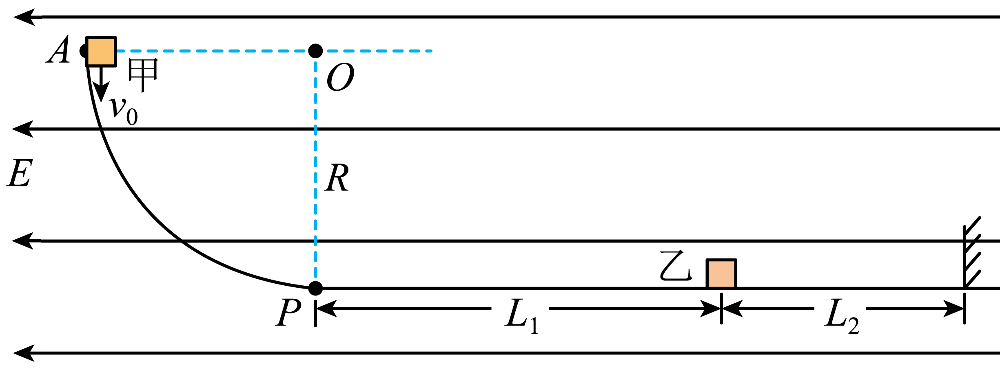

# Physics - 题目 2715

**ID**: ce9dc2c1b6ed47119ce2146fd94f934a
**年级**: Grade 11
**难度**: Medium-Hard
**题型**: Calculation

## 题目
如图所示，光滑 $\frac {1}{4}$ 圆弧轨道竖直固定，与水平面相切于最低点P，半径 $R=0.2{\rm{m}}$ ，空间中存在水平向左的匀强电场，场强 $E=1\times 10{^{3}}{\rm{V}}{\rm{/}}{\rm{m}}$ ，物体甲的质量为 $m{{}_{1}}=0.2{\rm{k}}{\rm{g}}$ ，带负电，电荷量为 $q=1\times 10{^{-3}}{\rm{C}}$ ，在P点右侧 $L{{}_{1}}=1{\rm{m}}$ 处有一不带电的物体乙，质量为 $m{{}_{2}}=0.2{\rm{k}}{\rm{g}}$ ，物体乙右侧 ${L}_{2}=0.5\text{m}$ 处有一竖直固定挡板，甲物体从与圆心O等高的A点以竖直向下的速度 $v{{}_{0}}=2{\rm{m}}{\rm{/}}{\rm{s}}$ 滑动，甲、乙与水平面的动摩擦因数均为 $μ=0.2$ ，所有碰撞均无能量损失，且甲、乙碰撞没有电荷转移。​​​​​​​‌（1）在圆形轨道最低点P，物体甲受到轨道的支持力大小；（2）甲、乙第一次碰撞后各自的速度大小；（3）整个过程甲、乙在水平面上运动的总路程之和。

## 解答

1. （1）对物块甲，从A点到P点，由动能定理得 $m{{}_{1}}gR+EqR=\frac {1}{2}m{{}_{1}}v{{}_{1}^{2}}-\frac {1}{2}m{{}_{1}}v{{}_{0}^{2}}$ ，解得 $v{{}_{1}}=\sqrt {10}{\rm{m}}/{\rm{s}}$ ，在P点由牛顿第二定律可得 $F{{}_{{\rm{N}}}}-m{{}_{1}}g=m{{}_{1}}\frac {v{{}_{1}^{2}}}{R}$ ，解得物体甲受到轨道的支持力大小为 $F{{}_{{\rm{N}}}}=12{\rm{N}}$
2. （2）物块甲在水平面上向右运动，碰乙前，根据动能定理可得 $\left ({Eq-{\rm μm}{{}_{1}}g}\right )L{{}_{1}}=\frac {1}{2}m{{}_{1}}v{^{2}}-\frac {1}{2}m{{}_{1}}v{{}_{1}^{2}}$ ，解得碰撞前瞬间甲的速度大小为 $v=4{\rm{m}}/{\rm{s}}$ ，甲、乙相碰过程，根据动量守恒和机械能守恒可得 $m{{}_{1}}v=m{{}_{1}}v{{}_{甲}}+m{{}_{2}}v{{}_{乙}}$ ， $\frac {1}{2}m{{}_{1}}v{^{2}}=\frac {1}{2}m{{}_{1}}v{{}_{甲}^{2}}+\frac {1}{2}m{{}_{2}}v{{}_{乙}^{2}}$ ，联立解得 $v{{}_{甲}}=0$ ， $v{{}_{乙}}=4{\rm{m}}/{\rm{s}}$
3. （3）对物体甲受力分析，由于 $Eq=1{\rm{N}}>{\rm μm}{{}_{1}}g=0.4{\rm{N}}$ ，则物体甲、乙最终停在挡板处，在整个过程，对甲、乙系统，由能量守恒定律得 $\frac {1}{2}mv{{}_{0}^{2}}+mgR+Eq\left ({R+L{{}_{1}}+L{{}_{2}}}\right )={\rm μm}gS{{}_{总}}$ （令 $m{{}_{1}}=m{{}_{2}}=m$ ），解得整个过程甲、乙在水平面上运动的总路程之和为 $S{{}_{总}}=6.25{\rm{m}}$

## 知识点

**中文**:
  - 动量守恒的判定与应用
  - 带电粒子在匀强电场中的运动

**English**:
  - Judgment and Application of Momentum Conservation
  - Motion in Uniform Electric Field

---
