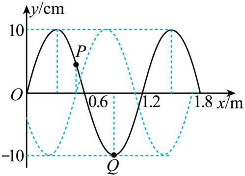

# Physics - 题目 2630

**ID**: d31bf3f424bf4324a15fff70c0d2587d
**年级**: Grade 11
**难度**: Medium-Hard
**题型**: Calculation

## 题目
一列简谐横波沿x轴传播在t=0时刻的波形如图中实线所示，t=0.5s时刻的波形如图中虚线所示，虚线恰好过质点P的平衡位置。​​​​​​​‌已知质点P平衡位置的坐标x=0.5m。求：（1）该简谐波传播的最小速度；（2）质点O的振动方程。

## 解答

1. （1）由图知，该波波长为 $λ=1.2{\rm{m}}{\rm ，}$ 若波沿x轴正方向传播，则有 $Δx{{}_{1}}=nλ+0.5$ （n=0，1，2……），则波速为 $v{{}_{1}}=\frac {Δx{{}_{1}}}{Δt}=\frac {nλ+0.5}{0.5}{\rm{m}}{\rm{/}}{\rm{s}}={\rm{(}}{{2}}{{.}}{{4}}n{{+}}{{1}}{\rm{)}}{\rm{m}}{\rm{/}}{\rm{s}}$ （n=0，1，2……），当n=0时，波速最小为 $v{{}_{1{\rm \min }}}={{1}}{\rm{m}}{\rm{/}}{\rm{s}}{\rm ，}$ 若波沿x轴负方向传播，则有 $Δx{{}_{2}}=nλ+0.7$ （n=0，1，2……），则波速为 $v{{}_{2}}=\frac {Δx{{}_{2}}}{Δt}=\frac {nλ+0.7}{0.5}{\rm{m}}{\rm{/}}{\rm{s}}={\rm{(}}{{2}}{{.}}{{4}}n{{+}}{{1}}{{.}}{{4}}{\rm{)}}{\rm{m}}{\rm{/}}{\rm{s}}$ （n=0，1，2……），当n=0时，波速最小为 $v{{}_{2{\rm \min }}}=1.4{\rm{m}}{\rm{/}}{\rm{s}}{\rm ，}$ 综上所述，该波的最小速度为1m/s；
2. （2）若波沿x轴正方向传播，则周期为 $T{{}_{1}}=\frac {λ}{v{{}_{1}}}=\frac {6}{5+12n}{\rm{s}}$ （n=0，1，2……），则质点О的振动方程为 $y=A\sin \left ({\frac {2π}{T{{}_{1}}}t}\right )=10\sin \left [\left ({\frac {5+12n}{3}}\right )πt\right ]cm$ （n=0，1，2……），若波沿x轴负方向传播，则周期为 $T{{}_{2}}=\frac {λ}{v{{}_{2}}}=\frac {6}{7+12n}{\rm{s}}$ （n=0，1，2……），则质点О的振动方程为 $y=A\sin \left ({\frac {2π}{T{{}_{2}}}t}\right )=10\sin \left [\left ({\frac {7+12n}{3}}\right )πt\right ]cm$ （n=0，1，2……）

## 知识点

**中文**:
  - 波的多解问题

**English**:
  - Multi-solution Problems in Waves

---
