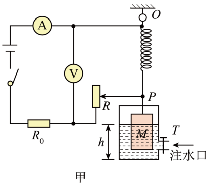
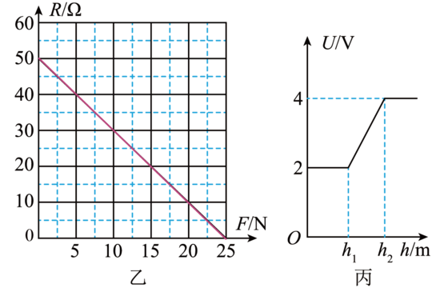

# Physics - 题目 2367

**ID**: d50c6a5b29e44acaa6d7903af759bfa6
**年级**: Grade 11
**难度**: Medium-Hard
**题型**: Calculation

## 题目
某物理兴趣小组设计了探测湖底未知属性的矿石密度的装置，其部分结构如图甲所示。​​​​​​​‌电源电压为 $6{\rm{V}}$ ， $R{{}_{0}}$ 为定值电阻，滑动变阻器R的阻值随弹簧的拉力变化关系如图乙。T为容器的阀门，某次探测时，水下机器人潜入 ${{1}}{{0}}{{0}}{\rm{m}}$ 深的湖底取出矿石样品M。返回实验室后，将矿石样品M悬挂于P点放入容器中，保持静止状态。打开阀门T，随着水缓慢注入容器，电压表示数U随容器中水的深度h变化关系如图丙中的实线所示。在电压表示数从 ${{2}}{\rm{V}}$ 变为 ${{4}}{\rm{V}}$ 的过程中，电流表示数变化值为 ${{0}}{{.}}{{2}}{\rm{A}}$ （弹簧电阻忽略不计），矿石M不吸水，湖水密度与水相同，假设容器足够高， $ρ{{}_{水}}=1.0\times 10{^{3}}{\rm{k}}{\rm{g}}/{\rm{m}}{^{3}}$ ，取 $g=10{\rm{N}}/{\rm{k}}{\rm{g}}$ 。求：（1）定值电阻 $R{{}_{0}}$ 的阻值是多少？（2）打开阀门T后，定值电阻 $R{{}_{0}}$ 的电功率变化值是多少？（3）矿石M的密度是多少？

## 解答

1. （1）根据 $E=IR{{}_{0}}+U$ ，可知 $R{{}_{0}}=\left |{\frac {\Delta U}{\Delta I}}\right |=\frac {4-2}{0.2}\Omega =10\Omega $
2. （2）电压表示数为2V时，电流为 $I{{}_{1}}=\frac {E-U{{}_{1}}}{R{{}_{0}}}=0.4{\rm{A}}$ ，电压表示数为4V时，电流为 $I{{}_{2}}=\frac {E-U{{}_{2}}}{R{{}_{0}}}=0.2{\rm{A}}$ ，打开阀门T后，定值电阻 $R{{}_{0}}$ 的电功率变化值为 $\Delta P=I{{}_{1}^{2}}R{{}_{0}}-I{{}_{2}^{2}}R{{}_{0}}=1.2{\rm{W}}$
3. （3）水深度在0~h_{1}时，矿石没有浸在水中，弹簧拉力最大，与重力平衡，滑动变阻器阻值为 $R{{}_{1}}=\frac {U{{}_{1}}}{I{{}_{1}}}=5Ω$ ，此时弹簧拉力为 $F{{}_{1}}=22.5{\rm{N}}$ ，即等于矿石重力。水深度大于h_{2}时，矿石浸没在水中，弹簧拉力最小，浮力最大，滑动变阻器阻值为 $R{{}_{2}}=\frac {U{{}_{2}}}{I{{}_{2}}}=20Ω$ ，此时弹簧拉力为 $F{{}_{2}}=15{\rm{N}}$ ，则矿石浸没在水中时所受浮力为 $F{{}_{浮}}=F{{}_{1}}-F{{}_{2}}=7.5{\rm{N}}$ ，根据 $F{{}_{浮}}=ρ{{}_{水}}gV{{}_{排}}$ ， $ρ=\frac {\frac {F{{}_{1}}}{g}}{V{{}_{排}}}$ ，得矿石M的密度是 $ρ=3\times 10{^{3}}{\rm{k}}{\rm{g}}{\rm{/}}{\rm{m}}{^{3}}$

## 知识点

**中文**:
  - 电路的动态分析问题
  - 闭合电路输出功率与效率

**English**:
  - Dynamic Circuit Analysis
  - Output Power and Efficiency of Closed Circuits

---
