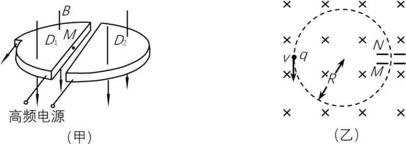

# Physics - 题目 2338

**ID**: d7a5ed150a4445a3b2e24ab77bc32a16
**年级**: Grade 11
**难度**: Medium-Hard
**题型**: Calculation

## 题目
我们熟知经典回旋加速器如图（甲）所示，带电粒子从M处经狭缝中的高频交流电压加速，进入与盒面垂直的匀强磁场的两个D形盒中做圆周运动，循环往复不断被加速，最终离开加速器。​​​​​​​‌另一种同步加速器，基本原理可以简化为如图（乙）所示模型，带电粒子从M板进入高压缝隙被加速，离开N板时，两板的电荷量均立即变为零，离开N板后，在匀强磁场的导引控制下回旋反复通过加速电场区不断加速，但带电粒子的旋转半径始终保持不变。已知带电粒子A的电荷量为+q，质量为m，带电粒子第一次进入磁场区时，两种加速器的磁场均为B_{0}，加速时狭缝间电压大小都恒为U，设带电粒子最初进入狭缝时的初速度为零，不计粒子受到的重力，不计粒子加速时间及其做圆周运动产生的电磁辐射，不考虑磁场变化对粒子速度的影响及相对论效应。（1）求带电粒子A每次经过两种加速器加速场时，动能的增量；（2）经典回旋加速器与同步加速器在装置上的类似性，源于它们在原理上的类似性。ａ．经典回旋加速器，带电粒子在不断被加速后，其在磁场中的旋转半径也会不断增加，求加速n次后r_{n}的大小；ｂ．同步加速器因其旋转半径R始终保持不变，因此磁场必须周期性递增，请推导B_{n}的表达式；（3）请你猜想一下，若带电粒子A与另一种带电粒子B（质量也为m，电荷量为+kq，k为大于1的整数）一起进入两种加速器，请分别说明两种粒子能否同时被加速，如果不能请说明原因，如果能，请推导说明理由。

## 解答

1. （1）粒子仅在狭缝间由电场加速，绕行过程中仅受洛伦兹力作用，洛伦兹力不会对粒子做功，根据动能定理： 每次动能的增量为：
2. $\vartriangle E{{}_{K}}=qU$
3. （2）a．在D形盒中洛伦兹力作向心力，磁感应强度不需要改变，当第n次穿过MN两板间开始作第n圈绕行时
4. $qv{{}_{n}}B{{}_{0}}=m\frac {v{{}_{n}^{2}}}{R{{}_{n}}}$
5. 第n圈的半径
6. $R{{}_{n}}=\frac {1}{B{{}_{0}}}\sqrt {\frac {2nUq}{m}}$
7. ｂ．同步加速器因其旋转半径始终保持不变，因此磁场必须周期性递增，洛伦兹力作向心力
8. $nqU=\frac {1}{2}mv{^{2}}$    ，    $qv{{}_{0}}B{{}_{0}}=m\frac {v{{}_{0}^{2}}}{R}$  ，   $qv{{}_{n}}B{{}_{n}}=m\frac {v{{}_{n}^{2}}}{R}$
9. 所以第n圈绕行的磁感应强度为：
10. $B{{}_{n}}=\sqrt {n}B{{}_{0}}$
11. （3）经典回旋加速器不能做到回旋加速，同步加速器仍然能做到回旋加速。经典回旋加速器，交变电压的周期与带电粒子回旋周期相同，加速A粒子的交变电压的周期为
12. $T=\frac {2πm}{B{{}_{0}}q}$
13. 而若要加速回旋加速粒子B，交变电压周期应为
14. $T{^{＇}}=\frac {2πm}{kB{{}_{0}}q}$
15. 因此当B粒子到达加速电场缝隙时，电压方向并没有反向，因此无法同时加速。同步加速器A粒子的磁场变化周期
16. $T{{}_{n}}=\frac {2πm}{qB{{}_{n}}}$
17. B粒子的旋转周期
18. $T＇=\frac {2πm}{kqB{{}_{n}}}=\frac {T{{}_{n}}}{k}$
19. $T{{}_{n}}$  是 $T^{′}$  的k倍，所以 ${\rm{A}}$  每绕行1周， ${\rm{B}}$  就绕行k周。由于电场只在 ${\rm{A}}$  通过时存在，故B仅在与A同时进入电场时才被加速。

## 知识点

**中文**:
  - 回旋加速器

**English**:
  - Cyclotron

---
