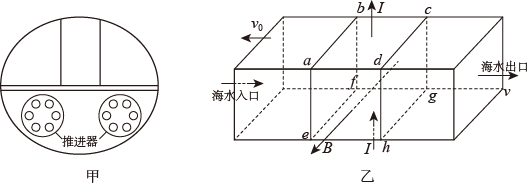

# Physics - 题目 779

**ID**: d866120581e44a56a81f2b6356d814f1
**年级**: Grade 11
**难度**: Medium-Hard
**题型**: Calculation

## 题目
为了提高潜艇的隐蔽性，就需要降低潜艇的噪音，而采用电磁推进器代替螺旋桨推进器是降低潜艇噪音的一个发展方向。​​​​​​​‌图甲是某种电磁推进器式潜艇的示意图，其下方有两组推进器，每组由6个完全相同的、相互独立的直线通道推进器构成，每个直线通道推进器的内部结构如图乙所示，在直线通道内充满了电阻率为 $ρ=0.2{\rm{Ω}}\cdot {\rm{m}}$ 的海水，通道中abcd-efgh的长方体空间内存在由电阻不计的励磁线圈产生的匀强磁场，磁感应强度大小为 $B=6{\rm{T}}$ ，方向垂直于adhe平面向外，abcd和efgh是两块与周围其他材料绝缘的金属板，当两金属板与专用直流电源相连后，在两板之间的海水中产生了沿e到a方向的恒定电流，设电流只存在于磁场区域。设海水原来是静止的，当两组推进器都开启，潜艇以 $v{{}_{0}}=15{\rm{m}}/{\rm{s}}$ 的恒定速度前进时，海水在出口处的速度为 $v=\sqrt {15}{\rm{m}}/{\rm{s}}$ ，牵引力的功率为 $P=3.24\times 10{^{5}}{\rm{W}}$ 。不计专用直流电源的内阻及导线电阻，已知海水密度 $ρ{{}_{m}}=1.0\times 10{^{3}}{\rm{k}}{\rm{g}}/{\rm{m}}{^{3}}$ ， $l{{}_{ad}}=l{{}_{ae}}=0.3{\rm{m}}$ ， $l{{}_{ab}}=0.4{\rm{m}}$ ， $\sqrt {15}\approx 3.87$ 。求：（1）每个直线通道推进器两金属板间的电流大小；（2）专用直流电源对12个推进器提供的总功率。（结果保留两位有效数字）

## 解答

1. （1）牵引力的功率
2. P=Fv_{0}
3. F=12BIl_{ae}
4. 解得
5. I=1.0×10^{3}A
6. （2）一个长方体内部海水的电阻
7. $R=ρ\frac {l{{}_{ae}}}{l{{}_{ab}}l{{}_{ad}}}=0.5Ω$
8. 海水的发热功率
9. P_{1}=12I^{2}R=6.0×10^{6}W
10. 单位时间内通过一个推进器的海水的质量
11. m=ρ_{m}l_{ab}l_{ae}v
12. 单位时间内海水动能的增加量
13. $P{{}_{2}}=12\cdot \frac {1}{2}mv{^{2}}=4.2\times 10{^{4}}{\rm{W}}$
14. 专用直流电源提供的总功率
15. P_{总}=P+P_{1}+P_{2}=6.4×10^{6}W

## 知识点

**中文**:
  - 安培力的大小
  - 闭合电路输出功率与效率

**English**:
  - Magnitude of Ampere Force
  - Output Power and Efficiency of Closed Circuits

---
