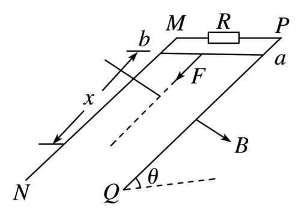

# Physics - 题目 1772

**ID**: d98ecfcc00f146a4b6519f6fa812af62
**年级**: Grade 11
**难度**: Medium-Hard
**题型**: Calculation

## 题目
如图所示，两根足够长的光滑直金属导轨MN、PQ平行固定在倾角θ＝37°的绝缘斜面上，两导轨间距L＝1 m，导轨的电阻可忽略．M、P两点间接有阻值为R的电阻．一根质量m＝1 kg、电阻r＝0.​​​​​​​‌2 Ω的均匀直金属杆ab放在两导轨上，与导轨垂直且接触良好．整套装置处于磁感应强度B＝0.5 T的匀强磁场中，磁场方向垂直导轨向下．自图示位置起，杆ab受到大小为F＝0.5v＋2(式中v为杆ab运动的速度，力F的单位为N)、方向沿导轨向下的拉力作用，由静止开始运动，测得通过电阻R的电流随时间均匀增大．g取10 m/s^{2}，sin 37°＝0.6.(1)试判断金属杆ab在匀强磁场中做何种运动，并写出推理过程；(2)求电阻R的阻值；(3)求金属杆ab由静止开始下滑通过位移x＝1 m所需的时间t.

## 解答

1. （1）金属杆做匀加速运动（或金属杆做初速为零的匀加速运动）．
2. 通过R的电流 $I=\frac {E}{R+r}=\frac {BLv}{R+r}$ ，因通过R的电流I随时间均匀增大，即杆的速度v随时间均匀增大，杆的加速度为恒量，故金属杆做匀加速运动．
3. （2）对杆，根据牛顿第二定律有：F+mgsinθ-BIL=ma
4. 将F=0.5v+2代入得：2+mgsinθ+（0.5- $\frac {B{^{2}}L{^{2}}}{R+r} $ ）v=ma，
5. 因a与v无关，所以a= $ \frac {2+mg\sin θ}{m}$ ＝8m/s^{2}
6. 代入得0.5- $\frac {B{^{2}}L{^{2}}}{R+r} $ =0 得R=0.3Ω
7. （3）由x= $\frac {1}{2}$at^{2}得，所需时间 $t=\sqrt {\frac {2x}{a}}$ =0.5s
8. 【点睛】
9. 本题考查运用数学知识研究物理问题的能力．关键是挖掘隐含条件，能从“电阻R的电流随时间均匀增大”中获取信息，根据牛顿第二定律求解加速度值.

## 知识点

**中文**:
  - 安培力的大小

**English**:
  - Magnitude of Ampere Force

---
