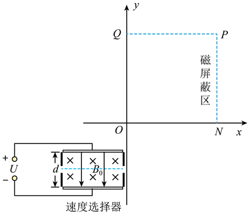

# Physics - 题目 1429

**ID**: da83206f389a4213a519de07b4755b04
**年级**: Grade 11
**难度**: Medium-Hard
**题型**: Calculation

## 题目
磁屏蔽技术可以降低外界磁场对屏蔽区域的干扰。​​​​​​​‌如图所示， $x⩾0$ 区域存在垂直 $Oxy$ 平面向里的匀强磁场，其磁感应强度大小为 $B{{}_{1}}$ （未知）。第一象限内存在边长为 $2L$ 的正方形磁屏蔽区ONPQ，经磁屏蔽后，该区域内的匀强磁场方向仍垂直 $Oxy$ 平面向里，其磁感应强度大小为 $B{{}_{2}}$ （未知），但满足 $0<B{{}_{2}}<B{{}_{1}}$ 。某质量为m、电荷量为 $q(q>0)$ 的带电粒子通过速度选择器后，在 $Oxy$ 平面内垂直y轴射入 $x⩾0$ 区域，经磁场偏转后刚好从ON中点垂直ON射入磁屏蔽区域。速度选择器两极板间电压U、间距d、内部磁感应强度大小 $B{{}_{0}}$ 已知，不考虑该粒子的重力。（1）求该粒子通过速度选择器的速率；（2）求 $B{{}_{1}}$ 以及y轴上可能检测到该粒子的范围；（3）定义磁屏蔽效率 $η=\frac {B{{}_{1}}-B{{}_{2}}}{B{{}_{1}}}\times 100\%$ ，若在Q处检测到该粒子，则 $η$ 是多少？

## 解答

1. （1）由于该粒子在速度选择器中受力平衡， $qE=qv{{}_{0}}B{{}_{0}}$
2. 其中 $E=\frac {U}{d}$
3. 则该粒子通过速度选择器的速率为 $v{{}_{0}}=\frac {U}{B{{}_{0}}d}$
4. （2）粒子在 $x⩾0$ 区域内做匀速圆周运动，从ON的中点垂直ON射入磁屏蔽区域，由几何关系可知 $r{{}_{1}}=L$
5. 由洛伦兹力提供给向心力 $qv{{}_{0}}B{{}_{1}}=m\frac {v{{}_{0}^{2}}}{r{{}_{1}}}$
6. 联立可得 $B{{}_{1}}=\frac {mU}{q{\rm dB}{{}_{0}}L}$
7. 由于 $B{{}_{2}}<B{{}_{1}}$ ，根据洛伦兹力提供给向心力 $qv{{}_{0}}B{{}_{2}}=m\frac {v{{}_{0}^{2}}}{r{{}_{2}}}$
8. 解得 $r{{}_{2}}>L$
9. 当 $B{{}_{2}}=0$ 时粒子磁屏蔽区向上做匀速直线运动，离开磁屏蔽区后根据左手定则，粒子向左偏转，如图所示
10. 
11. 根据洛伦兹力提供向心力 $qv{{}_{0}}B{{}_{1}}=m\frac {v{{}_{0}^{2}}}{r{{}_{3}}}$
12. 可得 $r{{}_{3}}=r{{}_{1}}=L$
13. 粒子打在y轴3L处，综上所述y轴上可能检测到该粒子的范围为 $L<y<3L$ 。
14. （3）若在Q处检测到该粒子，如图
15. 
16. 由几何关系可知 $r{{}_{2}^{2}}=(2L){^{2}}+(r{{}_{2}}-L){^{2}}$
17. 解得 $r{{}_{2}}=\frac {5}{2}L$
18. 由洛伦兹力提供向心力 $qv{{}_{0}}B{{}_{2}}=m\frac {v{{}_{0}^{2}}}{r{{}_{2}}}$
19. 联立解得 $B{{}_{2}}=\frac {2mU}{5qB{{}_{0}}dL}$
20. 其中 $B{{}_{1}}=\frac {mU}{q{\rm dB}{{}_{0}}L}$
21. 根据磁屏蔽效率 $η=\frac {B{{}_{1}}-B{{}_{2}}}{B{{}_{1}}}\times 100\%$ 可得若在Q处检测到该粒子，则 $η=60{\rm{\%}}$ 。

## 知识点

**中文**:
  - 带电粒子在有界磁场中运动的临界极值问题
  - 速度选择器

**English**:
  - Critical Extremum Problems in Bounded Magnetic Fields
  - Velocity Selector

---
