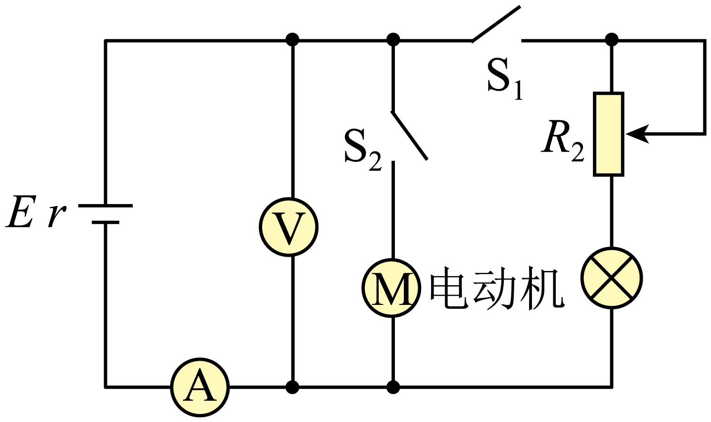

# Physics - 题目 395

**ID**: db3d9e5badfd40d7b346baac722574c4
**年级**: Grade 11
**难度**: Medium-Hard
**题型**: Calculation

## 题目
电动自行车的车灯和电动机（提供行驶动力）均由电瓶供电，工作原理简化为如图所示电路，查得电瓶的电动势 $E=48{\rm V}$ ，电瓶的内阻r未知。​​​​​​​‌在停车状态下打开车灯（ ${\rm{S}}{{}_{{{1}}}}$ 闭合、 ${\rm{S}}{{}_{2}}$ 断开），车灯正常发光，电流表的示数为1A，电压表的示数为44V；在打开车灯时行驶（ ${\rm{S}}{{}_{{{1}}}}$ 和 ${\rm{S}}{{}_{2}}$ 均闭合），调节 $R{{}_{2}}$ ，仍使车灯正常发光，此时电流表的示数为3.2A。若电动机内阻 $R{{}_{{\rm{M}}}}=2$  $Ω$ ，电流表和电压表均为理想电表，假定车灯灯丝电阻不变。求：（1）电源内阻r的值；（2）电动机的热功率；（3）打开车灯行驶时电动机的效率。

## 解答

1. （1） ${\rm{S}}{{}_{1}}$ 闭合、 ${\rm{S}}{{}_{2}}$ 断开时，根据闭合电路欧姆定律有 $E=U{{}_{1}}+I{{}_{1}}r$ ，解得 $r=4$  $Ω$
2. （2） ${\rm{S}}{{}_{1}}$ 、 ${\rm{S}}{{}_{2}}$ 均闭合时，流经车灯的电流 $I{{}_{{\rm{L}}}}=I{{}_{1}}=1{\rm A}$
3. 流过电动机的电流 $I{{}_{{\rm{M}}}}=I{{}_{2}}-I{{}_{{\rm{L}}}}=2.2{\rm A}$
4. 则电动机的发热功率 $P{{}_{{\rm{机}}}}=I{{}_{{\rm{M}}}^{2}}R{{}_{{\rm{M}}}}=9.68{\rm W}$
5. （3）电动机的输入功率 $P=U{{}_{2}}I{{}_{{\rm{M}}}}=\left ({E-I{{}_{2}}r}\right )I{{}_{{\rm{M}}}}=77.44{\rm W}$
6. 电动机输出的机械功率 $P{{}_{{\rm{机}}}}=P-P{{}_{{\rm{热}}}}=67.76{\rm W}$
7. 则电动机的效率： $η=\frac {P{{}_{机}}}{P}\times 100{\rm{\%}}=87.5{\rm{\%}}$

## 知识点

**中文**:
  - 非纯电阻电路中的电功、电功率和电热

**English**:
  - Work, Power, and Heat in Non-Pure Resistive Circuits

---
