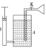

# Physics - 题目 1554

**ID**: dcb00e0f792f4b9ea4747a5f4791a3c8
**年级**: Grade 11
**难度**: Medium-Hard
**题型**: Calculation

## 题目
5月11日，水寨中学高二级迎来了复学日，为控制病毒的传播，我校特制定了校园消毒工作方案，要 求 校园内人员密集的公共场所，如课室、图书馆、饭堂等场所，需定期进行物表与空气消毒。​​​​​​​‌如图为我校物理老师设计制作的便携式消毒器原理图，桶内消毒液上方用塞子密封了一定质量的理想气体，已知气体初态压强与外界大气压相等，均为p_{0}，为使消毒液从喷头处雾化喷出，内部气体压强至少为1.5p_{o}，现用最大容积为0.1L的打气筒向桶内打气，打了5次刚好有消毒水喷出，（忽略桶内消毒液柱所产生的压强及打气过程中温度的变化）。求：（1）未打气前瓶内消毒液上方气体的体积为多少。（2）设瓶内消毒液总体积为19L，则至少需要打几次气才能把消毒液全部喷洒完。

## 解答

1. （1）设原来上方空气体积为V，
2. 已知：
3. $p{{}_{1}}=p{{}_{0}}$ ， $V{{}_{1}}=V+5\times 0.1{\rm{L}}=\left ({V+0.5}\right ){\rm{L}}$
4. $p{{}_{2}}=1.5p{{}_{0}}$ ，  $V{{}_{2}}=V$
5. 根据玻意尔定律 $p{{}_{1}}V{{}_{1}}=p{{}_{2}}V{{}_{2}}$ 得：
6. $p{{}_{0}}\times （V+0.5）=1.5p{{}_{0}}\times V$
7. 解得：
8. $V=1{\rm{L}}$
9. （2）设至少需要打n次
10. 已知：
11. $p{{}_{1}}=p{{}_{0}}$ ， $V{{}_{1}}=1{\rm{L}}{\rm{+}}n\times {\rm{0}}{\rm{.}}{\rm{1}}{\rm{L}}=\left ({1+0.1n}\right ){\rm{L}}$
12. $p{{}_{2}}{^{\prime }}=1.5p{{}_{0}}$ ， $V{{}_{2}}{^{\prime }}=20{\rm{L}}$
13. 根据玻意尔定律 $p{{}_{1}}V{{}_{1}}=p{{}_{2}}{^{\prime }}V{{}_{2}}{^{\prime }}$ 得：
14. $p{{}_{0}}\times （1+0.1n）{\rm{L}}=1.5p{{}_{0}}\times 20{\rm{L}}$
15. 解得：
16. $n=290$  次

## 知识点

**中文**:
  - 充气、抽气和灌气等问题

**English**:
  - Inflation, Evacuation, and Filling Problems

---
