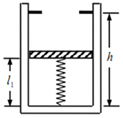

# Physics - 题目 887

**ID**: dd0c9d5908bc4bab95089e851dc1143c
**年级**: Grade 11
**难度**: Medium-Hard
**题型**: Calculation

## 题目
如图，一竖直放置的汽缸上端开口，汽缸壁内有卡口，卡口距缸底的高度h=20cm．汽缸活塞的面积S=100cm^{2}，重量G=100N，其下方密封有一定质量的理想气体，活塞只能在卡口下方上下移动．活塞和汽缸壁均绝热，不计它们之间的摩擦，竖直轻弹簧下端与缸底固定连接，上端与活塞固定连接，原长l_{0}=15cm，劲度系数k=2000N/m．开始时活塞处于静止状态，汽缸内气体温度T_{1}=200K，弹簧的长度l_{1}=10cm，现用电热丝缓慢加热汽缸中的气体（大气压P_{0}=1.​​​​​​​‌0×10^{5}Pa）．求（i）当弹簧恢复原长时时汽缸内气体的温度T_{2}；（ⅱ）当汽缸中的气体温度T_{3}=500K时汽缸内气体的压强P_{3}．

## 解答

1. （i）对活塞受力分析，开始时气体的压强为：
2. $P{{}_{1}}=P{{}_{0}}+\frac {G}{S}-\frac {F}{S}=1.0\times 10{^{5}}+\frac {100}{0.01}-\frac {2000\times \left ({0.15-0.1}\right )}{0.01}P{{}_{a}}=1.0\times 10{^{5}}P{{}_{a}}$
3. 温度为：T_{1}=200K
4. 体积为：V_{1}=lS=10S
5. 弹簧恢复原长时，对活塞受力分析，根据平衡得封闭气体压强为：
6. $P{{}_{2}}=P{{}_{0}}+\frac {G}{S}=1.0\times 10{^{5}}+\frac {100}{0.01}P{{}_{a}}=1.1\times 10{^{5}}$ P_{a}
7. 体积为：V_{2}=l_{0}S=15S
8. 由理想气体状态方程得：
9. $\frac {P{{}_{1}}V{{}_{1}}}{T{{}_{1}}}=\frac {P{{}_{2}}V{{}_{2}}}{T{{}_{2}}}$
10. 代入数据解得：T_{2}=330K
11. （ii）设温度为T时，活塞恰好上移至卡口，此时有：
12. $P=P{{}_{0}}+\frac {G}{S}+\frac {k\left ({h-l{{}_{0}}}\right )}{S}$ = $1.0\times 10{^{5}}+\frac {100}{0.01}+\frac {2000\times \left ({0.2-0.15}\right )}{0.01}P{{}_{a}}$ =1.2×10^{5}P_{a}
13. V=hS=20S
14. 由理想气体状态方程得： $\frac {P{{}_{1}}V{{}_{1}}}{T{{}_{1}}}=\frac {PV}{T}$
15. 代入数据解得：T=480K
16. 由于T_{3}=500K＞480K，活塞以上移至卡口，有：
17. V_{3}=hS=20S
18. 由理想气体状态方程得：
19. $\frac {P{{}_{1}}V{{}_{1}}}{T{{}_{1}}}=\frac {P{{}_{3}}V{{}_{3}}}{T{{}_{3}}}$
20. 代入数据解得： $P{{}_{3}}=1.25\times 10{^{5}}P{{}_{a}}$

## 知识点

**中文**:
  - 利用理想状态方程解决问题
  - 理想气体与理想气体状态方程

**English**:
  - Problem Solving using Ideal Gas Law
  - Ideal Gas and Ideal Gas Law

---
