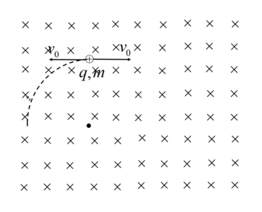

# Physics - 题目 173

**ID**: e0c2951915bf4285803511a5849fb557
**年级**: Grade 11
**难度**: Medium-Hard
**题型**: Calculation

## 题目
等效法是物理学经常运用的一种分析方法，经过等效处理使问题的条件得以简化、过程变得熟悉、思维得到活化。​​​​​​​‌例如：如图所示，空间中存在着水平方向的匀强磁场，磁感应强度为B，将一个质量为m、带电荷为+q的小球由静止释放，不计空气阻力，已知重力加速度为g。运动中小球受力及运动情况较为复杂，直接分析比较困难。现做等效处理：假设运动开始时小球A水平方向同时具有向左与向右的大小相等速度 $v{{}_{0}}$ （合速度依旧为零），且使 $v{{}_{0}}$ 满足： $Bqv{{}_{0}}=mg$ 。由于向右的运动速度 $v{{}_{0}}$ 使小球受到向上的洛伦兹力 $f{{}_{1}}=Bqv{{}_{0}}$ 与重力mg平衡。小球A相当于只受到由于向左速度 $v{{}_{0}}$ 而具有的洛伦兹力f_{2}作用，做逆时针方向的匀速圆周运动。这样，小球A的运动等效成：水平向右的匀速运动与竖直面上匀速圆周运动的合运动。请探究完成下列要求：(1)小球A应具有周期性运动的特点，请给予说明，并推导出计算时间周期的公式；(2)计算小球A运动中出现的最大速度；(3)请用两种方法，求出小球A距离初始位置下落的最大高度。

## 解答

1. (1)根据题意小球A的运动等效成水平向右的匀速运动与竖直面上匀速圆周运动的合运动，所以小球A运动的周期就是匀速圆周运动的周期，即
2. $T=\frac {2πR}{v{{}_{0}}}$
3. 洛伦兹力提供向心力
4. $qv{{}_{0}}B=m\frac {v{{}_{0}^{2}}}{R}$
5. 解得
6. $R=\frac {mv{{}_{0}}}{Bq}$
7. 联立方程解得周期
8. $T=\frac {2πm}{qB}$
9. (2)根据题意
10. $Bqv{{}_{0}}=mg$
11. 解得
12. $v{{}_{0}}=\frac {mg}{Bq}$
13. 小球A运动中出现的最大速度即圆周运动的速度方向与匀速直线运动的速度方向相同，所以
14. $v{{}_{{\rm{m}}}}=2v{{}_{0}}=\frac {2mg}{Bq}$
15. (3)第一种解法：从静止释放到速度最大时，根据动能定理
16. $mgh{{}_{{\rm \max }}}=\frac {1}{2}m(2v{{}_{0}}){^{2}}$
17. 解得
18. $h{{}_{{\rm \max }}}=\frac {2v{{}_{0}^{2}}}{g}=\frac {2m{^{2}}g}{B{^{2}}q{^{2}}}$
19. 第二种解法：粒子其中一个分运动为匀速圆周运动，运动下落的最大高度为圆周直径
20. $h{{}_{{\rm \max }}}=2R=\frac {2mv{{}_{0}}}{Bq}=\frac {2m{^{2}}g}{B{^{2}}q{^{2}}}$

## 知识点

**中文**:
  - 动能定理的简单应用
  - 带电粒子在叠加场中的运动

**English**:
  - Simple Applications of Work-Energy Theorem
  - Motion in Superimposed Fields

---
