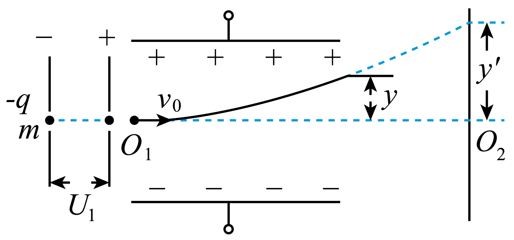

# Physics - 题目 315

**ID**: e21294cbb83e4e5cb198b7d8eafba104
**年级**: Grade 11
**难度**: Medium-Hard
**题型**: Calculation

## 题目
一个电荷量为q，质量为m的带电粒子，由静止经电压为U_{1}的加速电场加速后，立即沿中心线O_{1}O_{2}垂直进入一个偏转电场，从偏转电场射出时的动能为 $\frac {3}{2}qU{{}_{1}}$ ，然后打在垂直于O_{1}O_{2}放置的荧光屏上的P点（未画出），偏转电场两极板间距为d，极板长L，极板的右端与荧光屏之间的距离也为L。​​​​​​​‌整个装置如图示（不计粒子的重力）求：(1)粒子出加速电场时的速度v_{0}；(2)偏转电场的场强大小；(3)P点到O_{2}的距离y′。

## 解答

1. （1）粒子在加速电场中时
2. $qU{{}_{1}}=\frac {1}{2}mv{{}_{0}^{2}}$
3. 解得
4. $v{{}_{0}}=\sqrt {\frac {2qU{{}_{1}}}{m}}$
5. （2）在偏转电场中
6. $L=v{{}_{0}}t$
7. $y=\frac {1}{2}\frac {qE}{m}t{^{2}}$
8. 由动能定理
9. $qU{{}_{1}}+qEy=\frac {3}{2}qU{{}_{1}}$
10. 解得
11. $E=\frac {v{{}_{0}}}{L}\sqrt {\frac {mU{{}_{1}}}{q}}$
12. $y=\frac {L}{2v{{}_{0}}}\sqrt {\frac {qU{{}_{1}}}{m}}$
13. （3）由比例关系可知
14. $\frac {y^{′}}{y}=\frac {L+\frac {L}{2}}{\frac {L}{2}}=\frac {3}{1}$
15. 可得
16. $y^{′}=\frac {3L}{2v{{}_{0}}}\sqrt {\frac {qU{{}_{1}}}{m}}$

## 知识点

**中文**:
  - 带电粒子在匀强电场中的运动

**English**:
  - Motion in Uniform Electric Field

---
