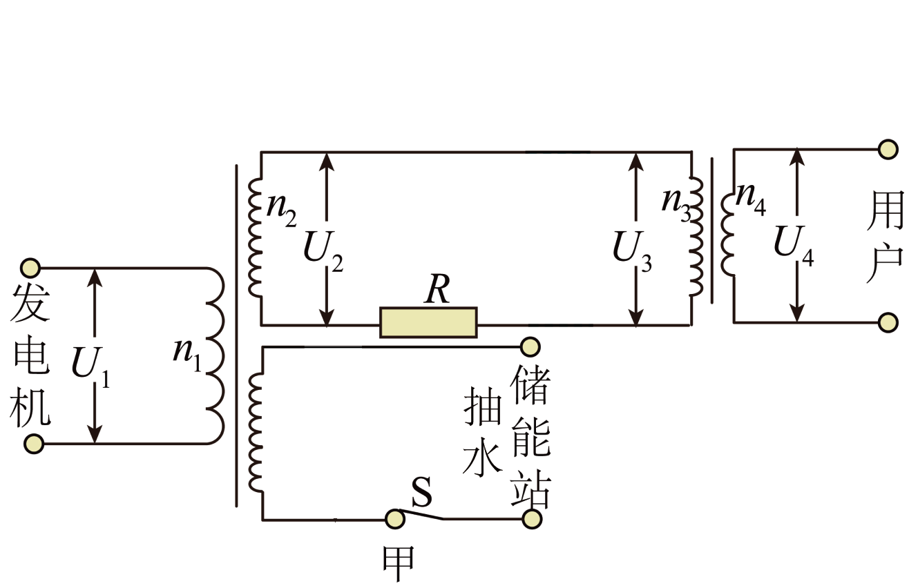
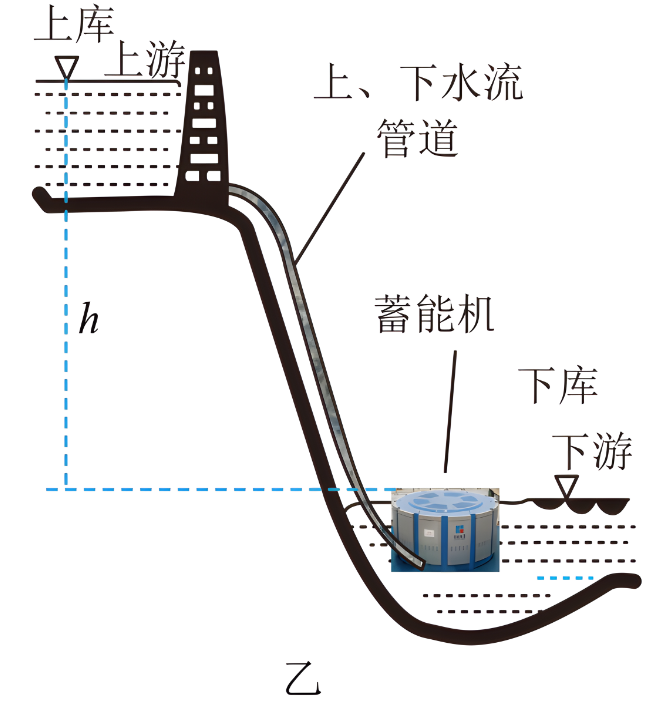

# Physics - 题目 721

**ID**: e6dfe997b251483ab04464912e31b7f7
**年级**: Grade 11
**难度**: Medium-Hard
**题型**: Calculation

## 题目
某节能储能输电网络图如图甲所示，发电机的输出电压 $U{{}_{1}}=210{\rm{V}}$ ，输出功率 $P{{}_{1}}=500{\rm{k}}{\rm{W}}$ ，降压变压器的匝数比 $n{{}_{3}}:n{{}_{4}}=40:1$ ，输电线总电阻 $R=80Ω$ ，其余线路电阻不计。​​​​​​​‌电力负荷低谷期时，用户端电压 $U{{}_{4}}=220{\rm{V}}$ ，功率 $P{{}_{4}}=22{\rm{k}}{\rm{W}}$ 。一般这时抽水储能站通过蓄能机带动水泵，如图乙所示，把水抽至上库，在电力负荷高峰期再放水至下库发电，填补用电缺口。抽水储能站上库的最大容量是固定的，抽水储能的效率 $η{{}_{抽}}={{8}}{{0}}{\rm{\%}}$ ，储能站将水的势能转化为电能的效率 $η{{}_{发}}=90{\rm{\%}}$ 。所有变压器均为理想变压器。求：（1）输电线上损失的功率P_{损}以及升压变压器的匝数比 $n{{}_{1}}:n{{}_{2}}$ ；（2）发电机输送沿储能站的功率P_{储}；（3）若开始时储能站上库处于干涸状态，在电力负荷低谷时抽水储能站给上水库蓄满水需要累积用时t=1×10^{6}s，请问在用电高峰期，把储能站上库蓄的水全部用来发电，能发出多少焦耳的电能？（计算结果保留一位有效数字）

## 解答

1. （1）用户电流 $I{{}_{4}}=\frac {P{{}_{4}}}{U{{}_{4}}}=100{\rm{A}}$
2. 输电线电流 $I{{}_{3}}=\frac {n{{}_{4}}}{n{{}_{3}}}I{{}_{4}}=2.5{\rm{A}}$
3. 输电线上损失的电压 $ΔU=I{{}_{3}}R=200{\rm{V}}$
4. 降压变压器原线圈电压 $U{{}_{3}}=\frac {n{{}_{3}}}{n{{}_{4}}}U{{}_{4}}=8800{\rm{V}}$
5. 升压变压器副线圈电压 $U{{}_{2}}=U{{}_{3}}+{\rm{Δ}}U=9000{\rm{V}}$
6. 升压变压器的匝数比 $\frac {n{{}_{1}}}{n{{}_{2}}}=\frac {U{{}_{1}}}{U{{}_{2}}}=\frac {210}{9000}=\frac {7}{300}$
7. 输电线上损失的功率为 ${\rm{Δ}}P=I{{}_{3}^{2}}R=500{\rm{W}}$
8. （2）理想变压器无功率损失，输送给储能电站的功率为 $P{{}_{储}}=P{{}_{1}}-P{{}_{4}}-{\rm{Δ}}P=477.5{\rm{k}}{\rm{W}}$
9. （3）由题意知，输送给储能电站的能量全部用来抽水，抽水耗能与抽水储能的关系为 $W{{}_{储}}=η{{}_{抽}}P{{}_{储}}t$
10. 代入数据得 $W{{}_{储}}=3.82\times 10{^{11}}{\rm{J}}$
11. 放水发的电为 $W{{}_{发}}=η{{}_{发}}W{{}_{储}}$
12. 代入数据得 $W{{}_{发}}=3\times 10{^{11}}{\rm{J}}$

## 知识点

**中文**:
  - 电能的输送

**English**:
  - Transmission of Electrical Energy

---
