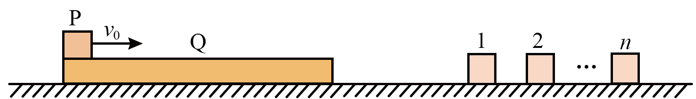

# Physics - 题目 2632

**ID**: e6e619238be3496e84a8216d81ab27d2
**年级**: Grade 11
**难度**: Medium-Hard
**题型**: Calculation

## 题目
如图所示，一质量 $m{{}_{2}}=1{\rm{k}}{\rm{g}}$ 且足够长的长木板 ${\rm{Q}}$ 静止在光滑的水平面上，长木板的右侧沿直线等间距的放置着 $n$ 个相同的滑块，滑块的质量均为 $m{{}_{3}}=3{\rm{k}}{\rm{g}}$ 。​​​​​​​‌现有一质量 $m{{}_{1}}=1{\rm{k}}{\rm{g}}$ 的物块 ${\rm{P}}$ 从长木板 ${\rm{Q}}$ 的左端以 $v{{}_{0}}=8{\rm{m}}/{\rm{s}}$ 的初速度滑上长木板 ${\rm{Q}}$ ，在长木板 ${\rm{Q}}$ 与滑块1发生碰撞前，物块 ${\rm{P}}$ 和长木板 ${\rm{Q}}$ 已共速。长木板 ${\rm{Q}}$ 上表面粗糙程度一致，所有的碰撞均为弹性碰撞，物块 ${\rm{P}}$ 和滑块均看作质点，重力加速度 $g$ 大小取 $10{\rm{m}}/{\rm{s}}{^{2}}$ ，求：（1）若物块 ${\rm{P}}$ 与长木板 ${\rm{Q}}$ 间的动摩擦因数为0.8，则从物块 ${\rm{P}}$ 滑上长木板 ${\rm{Q}}$ 至两者第一次共速时，物块 ${\rm{P}}$ 相对于长木板 ${\rm{Q}}$ 运动的距离为多少？（2）长木板Q与滑块1碰撞后瞬间，二者的速度大小分别为多少？（3）物块 ${\rm{P}}$ 最终的速度大小（结果用 $n$ 表示）。

## 解答

1. （1）物块 ${\rm{P}}$ 与长木板 ${\rm{Q}}$ 组成的系统动量守恒 $m{{}_{1}}v{{}_{0}}=\left ({m{{}_{1}}+m{{}_{2}}}\right )v{{}_{共1}}$
2. 解得 $v{{}_{共1}}=4{\rm{m}}/{\rm{s}}$
3. 根据能量守恒 ${\rm μm}{{}_{1}}gL=\frac {1}{2}m{{}_{1}}v{{}_{0}^{2}}-\frac {1}{2}\left ({m{{}_{1}}+m{{}_{2}}}\right )v{{}_{共1}^{2}}$
4. 解得 $L=2{\rm{m}}$
5. （2）物块P第一次与长木板Q共速后，长木板Q与滑块1发生弹性碰撞，根据动量守恒和机械能守恒 $m{{}_{2}}v{{}_{共1}}=m{{}_{2}}v{{}_{1}}+m{{}_{3}}v{{}_{1}}{^{\prime }}$
6. $\frac {1}{2}m{{}_{2}}v{{}_{共1}^{2}}=\frac {1}{2}m{{}_{2}}v{{}_{1}^{2}}+\frac {1}{2}m{{}_{3}}v^{′}{{{}_{1}^{2}}}$
7. 解得 $v{{}_{1}}=-2{\rm{m}}/{\rm{s}}$
8. $v{{}_{1}}{^{^{′}}}=2{\rm{m}}/{\rm{s}}$
9. （3）由于所有滑块质量相等，发生的碰撞都是弹性碰撞，所以滑块之间碰撞后交换速度，则第 $n$ 个滑块碰后的速度为 $v{{}_{1}}{^{\prime }}=2{\rm{m}}/{\rm{s}}$ ，其它滑块处于静止。
10. 长木板 ${\rm{Q}}$ 与滑块第一次碰撞后，物块 ${\rm{P}}$ 第二次与长木板 ${\rm{Q}}$ 共速过程，根据动量守恒 $m{{}_{1}}v{{}_{共1}}+m{{}_{2}}v{{}_{1}}=\left ({m{{}_{1}}+m{{}_{2}}}\right )v{{}_{共2}}$
11. 解得 $v{{}_{共2}}=\frac {v{{}_{0}}}{2}\cdot \frac {1}{4}=1{\rm{m}}/{\rm{s}}$
12. 同理可知长木板 ${\rm{Q}}$ 与滑块1第二次发生弹性碰撞后的速度分别为 $v{{}_{2}}=\frac {m{{}_{2}}-m{{}_{3}}}{m{{}_{2}}+m{{}_{3}}}v{{}_{共2}}=-\frac {1}{2}v{{}_{共2}}=-\frac {1}{2}{\rm{m}}/{\rm{s}}$
13. $v{{}_{2}}{^{\prime }}^{′}=\frac {2m{{}_{2}}}{m{{}_{2}}+m{{}_{3}}}v{{}_{共2}}=\frac {1}{2}v{{}_{共2}}=\frac {1}{2}{\rm{m}}/{\rm{s}}$
14. 可知第 $\left ({n-1}\right )$ 块滑块碰后的速度为 $v{{}_{2}}{^{\prime }}=\frac {1}{2}{\rm{m}}/{\rm{s}}$ ，其它滑块处于静止
15. 接着物块 ${\rm{P}}$ 第三次与长木板 ${\rm{Q}}$ 共速的速度为 $v{{}_{共{{3}}}}=\frac {v{{}_{0}}}{2}\cdot {\left({\frac {1}{4}}\right)^{2}}=\frac {1}{4}{\rm{m}}/{\rm{s}}$
16. 长木板 ${\rm{Q}}$ 与滑块1第三次发生弹性碰撞后的速度分别为 $v{{}_{3}}=\frac {m{{}_{2}}-m{{}_{3}}}{m{{}_{2}}+m{{}_{3}}}v{{}_{共{{3}}}}=-\frac {1}{2}v{{}_{共{{3}}}}=-\frac {1}{8}{\rm{m}}/{\rm{s}}$
17. $v{{}_{3}}^{′}=\frac {2m{{}_{2}}}{m{{}_{2}}+m{{}_{3}}}v{{}_{共{{3}}}}=\frac {1}{2}v{{}_{共{{3}}}}=\frac {1}{8}{\rm{m}}/{\rm{s}}$
18. 综上分析可知，长木板 ${\rm{Q}}$ 与滑块1第 $n$ 次发生弹性碰撞后，物块 ${\rm{P}}$ 第 $\left ({n+1}\right )$ 次与长木板 ${\rm{Q}}$ 共速的速度为物块 ${\rm{P}}$ 最终的速度 $v{{}_{终}}=\frac {v{{}_{0}}}{2}\cdot {\left({\frac {1}{4}}\right)^{n}}={\left({\frac {1}{4}}\right)^{n-1}}{\rm{m}}/{\rm{s}}$

## 知识点

**中文**:
  - 动量守恒与板块模型相结合
  - 动量守恒中的多次碰撞问题

**English**:
  - Momentum Conservation with Plate Models
  - Multiple Collisions in Momentum Conservation

---
