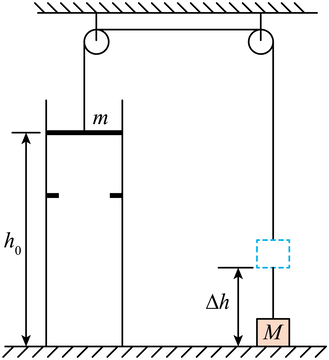

# Physics - 题目 1968

**ID**: e8cf95607f094eb39460269310f1db8d
**年级**: Grade 11
**难度**: Medium-Hard
**题型**: Calculation

## 题目
如图所示，固定在水平地面开口向上的圆柱形导热汽缸用质量为 $m$ 的活塞密封一定质量的理想气体，活塞可以在汽缸内无摩擦移动。​​​​​​​‌活塞用不可伸长的轻绳跨过两个定滑轮与地面上的物块连接。初始时，活塞与缸底的距离为 $h$ ，缸内气体温度为 $T{{}_{0}}$ ，轻绳恰好处于伸直状态且无拉力，活塞横截面积为 $\mathrm{S}$ ，已知大气压强 $p{{}_{0}}=\frac {5mg}{S}$ ，重力加速度为 $g$ ，忽略一切摩擦，物块可视为质点。现使缸内气体温度缓慢下降至 $0.5T{{}_{0}}$ ，此时物块对地面恰好无压力。（1）求物块的质量 $M$ ；（2）继续缓慢降低气体温度至 $0.3T{{}_{0}}$ ，求物块上升高度 $Δh$ ；（3）从初始至气体温度缓慢降低为 $0.3T{{}_{0}}$ 的过程，气体放出的热量为 $Q$ ，求全过程气体内能变化量。

## 解答

1. （1）初始时，对活塞 $p{{}_{0}}S+mg=p{{}_{1}}S$
2. 解得 $p{{}_{1}}=\frac {p{{}_{0}}S+mg}{S}=\frac {6mg}{S}$
3. 温度降至0.5T_{0}时，对活塞有
4. $p{{}_{0}}S+mg=p{{}_{2}}S+Mg$
5. 解得 $p{{}_{2}}=p{{}_{0}}+\frac {mg-Mg}{S}$
6. 由 $\frac {p{{}_{1}}}{T{{}_{1}}}=\frac {p{{}_{2}}}{T{{}_{2}}}$ 得
7. $p{{}_{2}}=\frac {p{{}_{1}}T{{}_{2}}}{T{{}_{1}}}$
8. 代入数据得 $p{{}_{2}}=\frac {3mg}{S}{\rm ，\mathit{M=}3\mathit{mg}}$
9. （2）由盖—吕萨克定律得 $\frac {T{{}_{3}}}{hS-ΔhS}=\frac {T{{}_{2}}}{hS}$
10. 解得 $\Delta h=\frac {2}{5}h$
11. （3）由热力学第一定律得，气体的内能变化 $ΔU=ΔU{{}_{1}}+ΔU{{}_{2}}=W{{}_{1}}+W{{}_{2}}-Q$
12. $W{{}_{1}}=0$ ， $W{{}_{2}}=p{{}_{2}}ΔV=p{{}_{2}}ΔhS=1.2mgh$
13. 联立得 $ΔU=1.2mgh-Q$

## 知识点

**中文**:
  - 热力学第一定律与理想气体状态方程的综合应用

**English**:
  - Integrated Application of 1st Law and Ideal Gas Law

---
