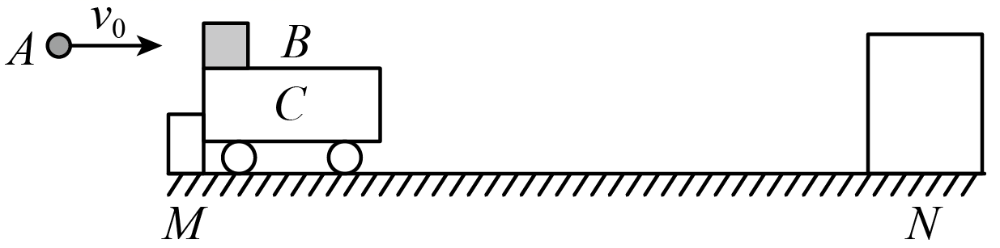

# Physics - 题目 956

**ID**: ea3bee7f6a6c4875954e6cee4009e60f
**年级**: Grade 11
**难度**: Medium-Hard
**题型**: Calculation

## 题目
如图所示，放在光滑水平面上的小车可以在两个固定障碍物M、N之间往返运动。​​​​​​​‌小车C最左端放有一个小木块B，初始时小车紧挨障碍物M静止。某时刻，一粒子弹A以速度v_{0}射中小木块并嵌入其中。小车向右运动到与障碍物N相碰时，小木块B恰好运动到了小车的最右端，且小车与小木块恰好达到共速。小车和它上面的小木块同时与障碍物B相碰，碰后小车速度立即减为零，而小木块B以碰撞之前的速度反弹，过一段时间，小车左端又与障碍物M相碰，碰后小车速度立即减为零，小木块B继续在小车上向左滑动，速度逐渐减为零而停在小车上。已知子弹A质量为m，小木块B质量为4m，小车C的质量为10m，长度为L。子弹和小木块都可以看做质点，求：（1）小木块B运动过程中的最大速度；（2）障碍物MN之间的距离；（3）小木块最终停止时，距小车右端的距离。

## 解答

1. (1)设子弹和木块的共同速度为v_{1}，根据动量守恒定律
2. mv_{0}=(m+4m)v_{1}
3. 解得
4. $v{{}_{1}}=\frac {v{{}_{0}}}{5}$
5. (2)内嵌子弹的小木块与小车作用过程，系统动量守恒，设共同速度为v_{2}，则有
6. (m+4m)v_{1}=(m+4m+10m)v_{2}
7. 解得
8. $v{{}_{2}}=\frac {v{{}_{0}}}{15}$
9. 小木块与小车之间的摩擦力为f，木块从A运动到B的路程为s
10. $-fs=\frac {1}{2}\left ({m+4m}\right )v{{}_{2}^{2}}-\frac {1}{2}\left ({m+4m}\right )v{{}_{1}^{2}}$
11. 对小车有
12. $f\left ({s-L}\right )=\frac {1}{2}\cdot 10m\cdot v{{}_{2}^{2}}$
13. 解得
14. $s=\frac {4L}{3}$
15. (3)内嵌子弹的小木块反弹后与小车达到相对静止状态，共同速度为v_{3}，相对小车滑行的距离为s_{1}，小车停后小木块做匀减速运动，相对小车滑行距离为s_{2}
16. 根据动量守恒有
17. （m+4m）v_{2}=（m+4m+10m）v_{3}
18. 解得
19. $v{{}_{3}}=\frac {1}{3}v{{}_{2}}=\frac {v{{}_{0}}}{45}$
20. 根据能量守恒
21. $fs{{}_{1}}=\frac {1}{2}\times \left ({\frac {1}{10}m+\frac {2}{5}m}\right )v{{}_{2}^{2}}-\frac {1}{2}\times \left ({\frac {1}{10}m+\frac {2}{5}m+m}\right )v{{}_{3}^{2}}$
22. 对内嵌子弹的小木块，根据动能定理有
23. $fs{{}_{2}}=\frac {1}{2}\times \left ({\frac {1}{10}m+\frac {2}{5}m}\right )v{{}_{3}^{2}}$
24. 解得
25. $s{{}_{1}}=\frac {L}{9}$
26. $s{{}_{2}}=\frac {L}{54}$
27. 内嵌子弹的小木块在小车上的位置与小车右端的距离
28. $x=s{{}_{1}}+s{{}_{2}}=\frac {7L}{54}$

## 知识点

**中文**:
  - 动量守恒与板块模型相结合
  - 子弹打木块模型中的能量守恒问题
  - 板块模型中的能量守恒问题
  - 子弹-木块模型

**English**:
  - Momentum Conservation with Plate Models
  - Energy Conservation in Bullet-Block Models
  - Energy Conservation in Plate Models
  - Bullet-Block Model

---
