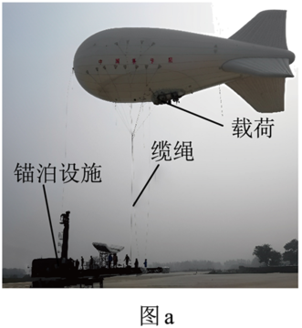
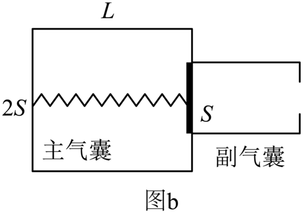

# Physics - 题目 1514

**ID**: ea50d453ba9746d39a61fb84ddbccf58
**年级**: Grade 11
**难度**: Medium-Hard
**题型**: Calculation

## 题目
如图a所示，系留气球是一种带有缆绳约束的浮空器，通常由球体、系留缆绳和系留设施组成。​​​​​​​‌在通讯、遥测、侦察、干扰和预警等领域有着广泛的应用。图b为某一“系留气球”的简化模型图；主、副气囊通过无漏气、无摩擦的活塞分隔，主气囊内封闭有一定质量的氦气（可视为理想气体），副气囊与大气连通。其中主气囊截面积为 $2S$ ，长度为 $L$ ；副气囊截面积为 $\mathrm{S}$ 。轻质弹簧左端固定、右端与轻质活塞连接。当气球在地面达到平衡时，弹簧处于原长状态，且自由端恰好在主副气囊连接处。在气球升空过程中，大气压强逐渐减小，弹簧被缓慢拉伸。当气球上升至目标高度时，活塞向右移动的距离为 $\frac {1}{2}L$ ，此时活塞两侧气体压强差为地面大气压强的 $\frac {1}{5}$ 。已知地面大气压强 $p{{}_{0}}$ 、温度 $T{{}_{0}}$ ，弹簧始终处于弹性限度内，活塞厚度忽略不计。（1）若气球升空过程中氦气温度不变，求目标高度处的大气压强 $p$ 。（2）气球在目标高度处驻留期间，设该处大气压强不变。气球内外温度达到平衡时，弹簧伸长量为 $\frac {1}{4}L$ ，求气球驻留处的大气温度 $T$ 。（3）若理想气体内能满足 $U=αT$ ，其中 $α$ 为已知常量。则气球从到达上述目标高度到内外温度达到平衡过程中，判断气体是吸热还是放热？并求出热量 $Q$ 的大小。

## 解答

1. （1）若气球升空过程中氦气温度不变，对主气囊内被封闭的氦气，其在地面附近时有 $p{{}_{1}}=p{{}_{0}}$ ， $V{{}_{1}}=2SL$ ，在目标高度处有 $p{{}_{2}}-p=\frac {1}{5}p{{}_{0}}$ ， $V{{}_{2}}=2SL+S\cdot \frac {1}{2}L=\frac {5}{2}SL$ ，由玻意耳定律可得 $p{{}_{1}}V{{}_{1}}=p{{}_{2}}V{{}_{2}}$ ，联立解得 $p{{}_{2}}=\frac {4}{5}p{{}_{0}}$ ， $p=\frac {3}{5}p{{}_{0}}$
2. （2）根据题意可知气球刚上升至目标高度时，弹簧伸长量为 $\frac {1}{2}L$ ，根据受力平衡可得 $p{{}_{2}}S=pS+k\cdot \frac {1}{2}L$ ，气球内外温度达到平衡时，有 $p{{}_{3}}S=pS+k\cdot \frac {1}{4}L$ ，解得 $p{{}_{3}}=\frac {7}{10}p{{}_{0}}$ ，根据理想气体状态方程可得 $\frac {p{{}_{2}}V{{}_{2}}}{T{{}_{0}}}=\frac {p{{}_{3}}V{{}_{3}}}{T}$ ，其中 $V{{}_{3}}=2SL+S\cdot \frac {1}{4}L=\frac {9}{4}SL$ ，联立解得 $T=\frac {63}{80}T{{}_{0}}$
3. （3）气球从到达上述目标高度到内外温度达到平衡过程中，温度减小，气体内能减小，气体体积减小，外界对气体做正功，根据热力学第一定律可知，气体向外界放热，则气体内能变化量为 $ΔU=αT-αT{{}_{0}}=-\frac {17}{80}αT{{}_{0}}$ ，外界对气体做的功为 $W=pS\cdot \frac {1}{4}L+\frac {k\cdot \frac {1}{2}L+k\cdot \frac {1}{4}L}{2}\cdot \frac {1}{4}L=\frac {3}{16}p{{}_{0}}SL$ ，根据 $ΔU=W-Q$ ，解得气体放热大小为 $Q=\frac {17}{80}αT{{}_{0}}+\frac {3}{16}p{{}_{0}}SL$

## 知识点

**中文**:
  - 热力学第一定律与理想气体状态方程的综合应用

**English**:
  - Integrated Application of 1st Law and Ideal Gas Law

---
