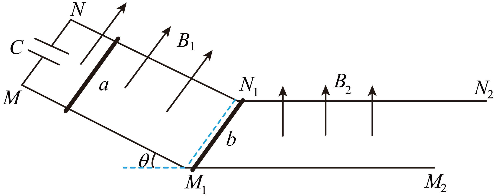

# Physics - 题目 777

**ID**: eaf9e9fd69a64953848e77e03860ca84
**年级**: Grade 11
**难度**: Medium-Hard
**题型**: Calculation

## 题目
如图所示，间距为L且足够长的光滑平行金属导轨MM_{1}M_{2}与NN_{1}N_{2}，由倾角为θ的倾斜导轨和水平导轨两部分组成，两部分导轨平滑连接但彼此绝缘。​​​​​​​‌倾斜导轨顶端MN之间连接一电容为C的电容器，且处于垂直于导轨平面向上、磁感应强度大小为B_{1}的匀强磁场中；水平导轨间有竖直向上、磁感应强度大小为B_{2}匀强磁场。质量为m、阻值不计的金属棒a从倾斜导轨某位置由静止开始释放，刚过斜面底端M_{1}N_{1}时与静止的导体棒b发生弹性正碰。已知导体棒b的质量为 $\frac {m}{2}$ ，阻值为r，重力加速度为g，两金属棒始终与导轨垂直且接触良好，金属导轨电阻不计，求：（1）分析导体棒a在斜面上的运动状态，写出必要的计算过程：（2）若已知导体棒a到达斜面底端时速度为v，试求碰撞后瞬间导体棒b的速度大小；（3）在（2）问条件下，两导体棒碰撞后达到稳定状态时，两导体棒之间的距离。

## 解答

1. （1）导体棒a在运动过程中受力示意图如图所示
2. 
3. 由牛顿第二定律可得 $mg\sin θ-B{{}_{1}}IL=ma$
4. 导体棒做切割磁感线运动，产生电动势为 $E=B{{}_{1}}Lv$
5. 电容器具有的电荷量 $Q=CB{{}_{1}}Lv$ ， $I=\frac {ΔQ}{Δt}=\frac {CB{{}_{1}}LΔv}{Δt}=CB{{}_{1}}La$
6. 由此可以求得导体棒运动的加速度 $a=\frac {mg\sin θ}{CB{{}_{1}^{2}}L{^{2}}+m}$
7. 导体棒a做匀加速直线运动
8. （2）导体棒a与b发生弹性正碰，动量守恒，机械能守恒，可得 $mv=mv{{}_{a}}+\frac {m}{2}v{{}_{b}}$ ， $\frac {1}{2}mv{^{2}}=\frac {1}{2}mv{{}_{a}^{2}}+\frac {1}{2}\cdot \frac {m}{2}v{{}_{b}^{2}}$
9. 解得 $v{{}_{b}}=\frac {4}{3}v$
10. （3）最终稳定时两棒无感应电流，速度相等，设为v_{共}，由动量守恒得 $mv=\left ({m+\frac {m}{2}}\right )v{{}_{共}}$
11. 解得 $v{{}_{共}}=\frac {2}{3}v$
12. 碰撞之后，导体棒a和b均在磁场中做切割磁感线运动，构成了闭合回路，回路中的电流 $I=\frac {B{{}_{2}}L\left ({v^{′}{{{}_{b}}}-v^{′}{{{}_{a}}}}\right )}{r}$
13. 对导体棒b运用动量定理可得 $-\sum B{{}_{2}}IL\cdot {\rm{Δ}}t=\frac {m}{2}v{{}_{共}}-\frac {m}{2}v{{}_{b}}$
14. 即 $\sum B{{}_{2}}L\cdot \frac {B{{}_{2}}L\left ({v^{′}{{{}_{b}}}-v^{′}{{{}_{a}}}}\right )}{r}{\rm{Δ}}t=\frac {m}{2}\left ({v{{}_{b}}-v{{}_{共}}}\right )$
15. 而 $\sum \left ({v^{′}{{{}_{b}}}-v^{′}{{{}_{a}}}}\right )\cdot {\rm{Δ}}t=x{{}_{b}}-x{{}_{a}}$
16. 由此可得，两导体棒之间的距离为 $Δx=x{{}_{b}}-x{{}_{a}}=\frac {mvr}{3B{{}_{2}^{2}}L{^{2}}}$

## 知识点

**中文**:
  - 双杆模型
  - 导体切割磁感线产生感应电动势（电流）的分析与计算
  - 求解弹性碰撞问题

**English**:
  - Double Rod Model
  - Analysis and Calculation of Cutting Magnetic Field Lines
  - Solving Elastic Collision Problems

---
