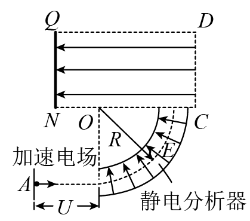

# Physics - 题目 381

**ID**: f0adf0044d00404d919894519dc1a5ff
**年级**: Grade 11
**难度**: Medium-Hard
**题型**: Calculation

## 题目
如图所示，静止于A处的离子，先经加速电场加速后能沿图中圆弧虚线匀速率地通过静电分析器，静电分析器通道内有均匀辐射方向分布的电场，然后再从P点垂直CN进入矩形区域的有界匀强电场，场强方向水平向左。​​​​​​​‌已知加速电场的电压为U，圆弧虚线的半径为R，离子质量为m、电荷量为q，QN=d、PN=2d，离子重力不计。求：（1）离子离开加速器时候的速率v；以及圆弧虚线所在处电场强度E的大小；（2）若离子恰好能打在Q点上，则矩形区域QNCD内电场强度 $E^{′}$ 的大小；（3）从A到Q点的整个运动过程，离子电势能的变化量 $ΔE{{}_{{\rm{p}}}}$ 。

## 解答

1. （1）离子在加速电场中加速，根据动能定理 $Uq=\frac {1}{2}mv{^{2}}$
2. 可得 $v=\sqrt {\frac {2qU}{m}}$
3. 离子在辐向电场中做匀速圆周运动，电场力提供向心力，根据牛顿第二定律得 $qE=\frac {mv{^{2}}}{R}$
4. 联立可得 $E=\frac {2U}{R}$
5. （2）离子矩形区域QNCD内做类平抛运动，加速度为 $a=\frac {qE^{′}}{m}$
6. 沿电场方向和垂直电场方向的位移分别为 $2d=\frac {1}{2}at{^{2}}$ ， $d=vt$
7. 联立可得 $E^{′}=\frac {8U}{d}$
8. （3）从A到Q点的整个运动过程，电场力对离子所做的总功为 $W=W{{}_{1}}+W{{}_{2}}=qU+qE^{′}{\cdot }2d=17qU$
9. 离子电势能的变化为 ${\rm{Δ}}E{{}_{{\rm{p}}}}=-W=-17qU$

## 知识点

**中文**:
  - 带电粒子在电场中的运动

**English**:
  - Motion of Charged Particles in Electric Fields

---
