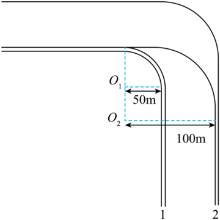

# Physics - 题目 1794

**ID**: f25dd94e1f904b7d841ed27fdf405b6d
**年级**: Grade 11
**难度**: Medium-Hard
**题型**: Calculation

## 题目
F1赛车与奥运会和世界杯足球赛并称世界三大体育盛事，是人类身体极限和汽车工业极限的结合，在世界范围内具有极高的影响力。​​​​​​​‌为了更好的理解F1赛车为什么快，某同学将其驶过弯道的情景抽象为了一个简单的物理模型：假设在平坦的地面上有一圆弧形弯道，赛车视为质点，最大静摩擦力等于滑动摩擦力，g=10m/s^{2}。（1）若弯道半径为R=50m，某家用小轿车轮胎与地面动摩擦因数为μ_{1}=0.8。求该小轿车在不打滑的情况下通过该弯道的最大速度。（2）F1赛车通过使用特殊制造的热熔胎来增大与地面的动摩擦因数，并通过精细的空气动力学设计来获得额外下压力（视为一个竖直向下的恒力），最终提升在弯道中的速度。在某次测试中，F1赛车使用了与地面间动摩擦因数为μ=1.5的热熔胎，在不打滑的情况下驶过（1）问中同一弯道，其最大过弯速度为（1）问中小轿车的3倍。则空气提供了其车重多少倍的下压力。（3）赛车的最终成绩，不但与车有关，更是与人的驾驶技术有关。车手驾驶（2）问中的赛车，以全速v_{0}=360km/h从长直道进入一个90°圆弧弯道，通过弯道后又进入长直道加速至全速。已知赛车在直道上加、减速的加速度大小均为a=10m/s^{2}，试求不打滑情况下通过如图所示的两种线路（曲线部分均为圆弧，半径如图所示）的时间差（结果保留三位有效数字）。

## 解答

1. （1）由题意，若弯道半径为R_{1}=50m，根据牛顿第二定律有 $μ{{}_{1}}mg=m\frac {v{^{2}}}{R{{}_{1}}}$
2. 代入数据，求得最大转弯速度大小为v=20m/s
3. （2）由题意，设空气提供了其车重n倍的下压力。根据牛顿第二定律有 $μ{{}_{2}}\left ({n+1}\right )mg=m\frac {v{{}_{1}^{2}}}{R{{}_{1}}}$
4. 且v_{1}=3v=60m/s，联立求得n=3.8
5. （3）由题意，路线1圆弧半径R_{1}=50m，弯道速度v_{1}=60m/s，直道上加减速位移大小 $x{{}_{1}}=\frac {v{{}_{0}^{2}}-v{{}_{1}^{2}}}{2a}=320{\rm{m}}$
6. 路线2圆弧半径R_{2}=100m，此时弯道速度v_{2}满足 $m\frac {v{{}_{1}^{2}}}{R{{}_{1}}}=m\frac {v{{}_{2}^{2}}}{R{{}_{2}}}$
7. 求得 $v{{}_{2}}=60\sqrt {2}{\rm{m}}{\rm{/}}{\rm{s}}$
8. 直道上加减速位移大小 $x{{}_{2}}=\frac {v{{}_{0}^{2}}-v{{}_{2}^{2}}}{2a}=140{\rm{m}}$
9. 为使比较路程相等，路线2减速前增加一段匀速位移 $x^{′}{{{}_{2}}}=320{\rm{m}}-140{\rm{m}}=180{\rm{m}}$
10. 加速后增加一段匀速位移 $x^{′′}{{{}_{2}}}=320{\rm{m}}-{{1}}{{4}}{{0}}{\rm{m}}-{{5}}{{0}}{\rm{m}}=130{\rm{m}}$
11. 此时弯道1所用时间 $t{{}_{1}}=2\left ({\frac {v{{}_{0}}-v{{}_{1}}}{a}}\right )+\frac {\frac {π}{2}R{{}_{1}}}{v{{}_{1}}}=(8+\frac {5}{12}π){\rm{s}}$
12. 弯道2所用时间 $t{{}_{2}}=2\left ({\frac {v{{}_{0}}-v{{}_{2}}}{a}}\right )+\frac {\frac {π}{2}R{{}_{2}}}{v{{}_{2}}}+\frac {x^{′}{{{}_{2}}}+x^{′′}{{{}_{2}}}}{v{{}_{0}}}=\left ({23.1-12\sqrt {2}+\frac {5}{12}\sqrt {2}π}\right ){\rm{s}}$
13. 则 ${\rm{Δ}}t=t{{}_{1}}-t{{}_{2}}\approx 1.33{\rm{s}}$

## 知识点

**中文**:
  - 匀变速直线运动基本公式的灵活应用
  - 水平路面上车辆转弯问题

**English**:
  - Flexible Application of Basic UVRM Formulas
  - Vehicle Turning on Level Roads

---
