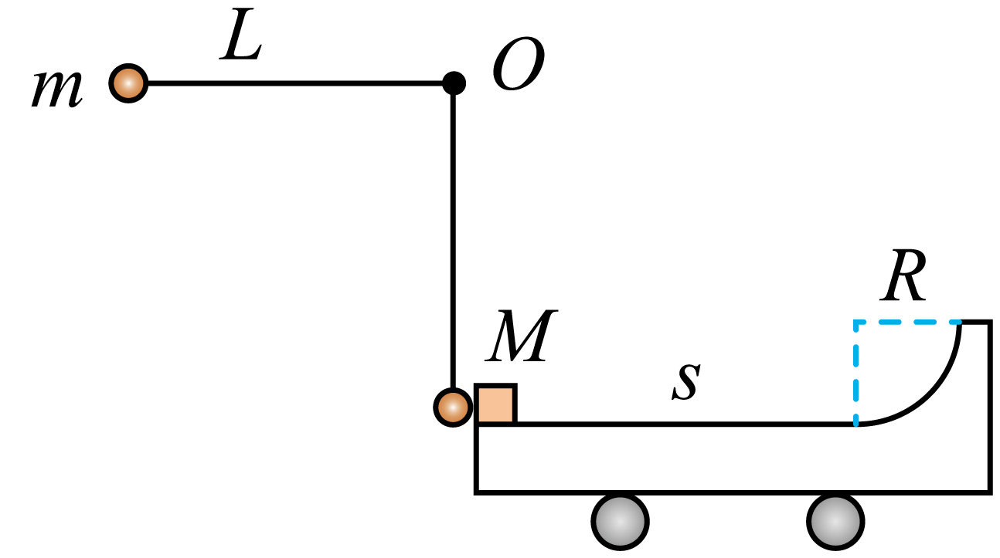

# Physics - 题目 800

**ID**: f4795a60965343398ac9bbcba36e8a7c
**年级**: Grade 11
**难度**: Medium-Hard
**题型**: Calculation

## 题目
如图所示，一实验小车静止在光滑水平面上，其上表面有粗糙水平轨道与光滑四分之一圆弧轨道，圆弧轨道与水平轨道相切于圆弧轨道最低点。​​​​​​​‌一物块静止于小车最左端，一小球用不可伸长的轻质细线悬挂于O点正下方，并轻靠在物块左侧。现将细线拉直到水平位置时，静止释放小球，小球运动到最低点时与物块发生弹性碰撞。碰撞后，物块沿着小车上的轨道运动。已知细线长 $L=1.25{\rm{m}}$ ，小球质量 $m=0.20{\rm{k}}{\rm{g}}$ ，物块、小车质量均为 $M=0.30{\rm{k}}{\rm{g}}$ ，小车上的水平轨道长 $s=1.0{\rm{m}}$ ，圆弧轨道半径 $R=0.15{\rm{m}}$ 。小球、物块均可视为质点，不计空气阻力，重力加速度g取 $10{\rm{m}}{\rm{/}}{\rm{s}}{^{2}}$ 。(1)求小球运动到最低点与物块碰撞前的速度大小和所受拉力的大小；(2)求小球与物块碰撞后的瞬间，物块速度的大小；(3)为使物块能进入圆弧轨道，且在上升阶段不脱离小车，求物块与水平轨道间的动摩擦因数μ的取值范围。

## 解答

1. （1）对小球摆动到最低点的过程中，由动能定理得
2. $mgL=\frac {1}{2}mv{{}_{0}^{2}}-0$
3. 解得
4. $v{{}_{0}}=5{\rm{m}}{\rm{/}}{\rm{s}}$
5. 在最低点，对小球由牛顿第二定律得
6. $F{{}_{{\rm{T}}}}-mg=m\frac {v{{}_{0}^{2}}}{L}$
7. 解得小球运动到最低点与物块碰撞前所受拉力的大小为
8. $F{{}_{{\rm{T}}}}=6{\rm{N}}$
9. （2）小球与物块碰撞过程中，由动量守恒定律和机械能守恒定律
10. $mv{{}_{0}}=mv{{}_{1}}+Mv{{}_{2}}$
11. $\frac {1}{2}mv{{}_{0}^{2}}=\frac {1}{2}mv{{}_{1}^{2}}+\frac {1}{2}Mv{{}_{2}^{2}}$
12. 解得小球与物块碰撞后的瞬间，物块速度的大小为
13. $v{{}_{2}}=\frac {2m}{m+M}v{{}_{0}}=4{\rm{m}}{\rm{/}}{\rm{s}}$
14. （3）若物块恰好运动到圆弧轨道的最低点，此时两者共速，则对物块与小车整体由水平方向动量守恒得
15. $Mv{{}_{2}}=2Mv{{}_{3}}$
16. 由能量守恒定律得
17. $\frac {1}{2}Mv{{}_{2}^{2}}=\frac {1}{2}\times 2Mv{{}_{3}^{2}}+μ{{}_{1}}Mgs$
18. 解得
19. $μ{{}_{1}}=0.4$
20. 若物块恰好运动到与圆弧圆心等高的位置，此时两者共速，则对物块与小车整体由水平方向动量守恒得
21. $Mv{{}_{2}}=2Mv{{}_{4}}$
22. 由能量守恒定律得
23. $\frac {1}{2}Mv{{}_{2}^{2}}=\frac {1}{2}\times 2Mv{{}_{4}^{2}}+μ{{}_{2}}Mgs+MgR$
24. 解得
25. $μ{{}_{2}}=0.25$
26. 综上所述物块与水平轨道间的动摩擦因数 $μ$ 的取值范围为
27. $0.25⩽μ<0.4$

## 知识点

**中文**:
  - 求解弹性碰撞问题

**English**:
  - Solving Elastic Collision Problems

---
