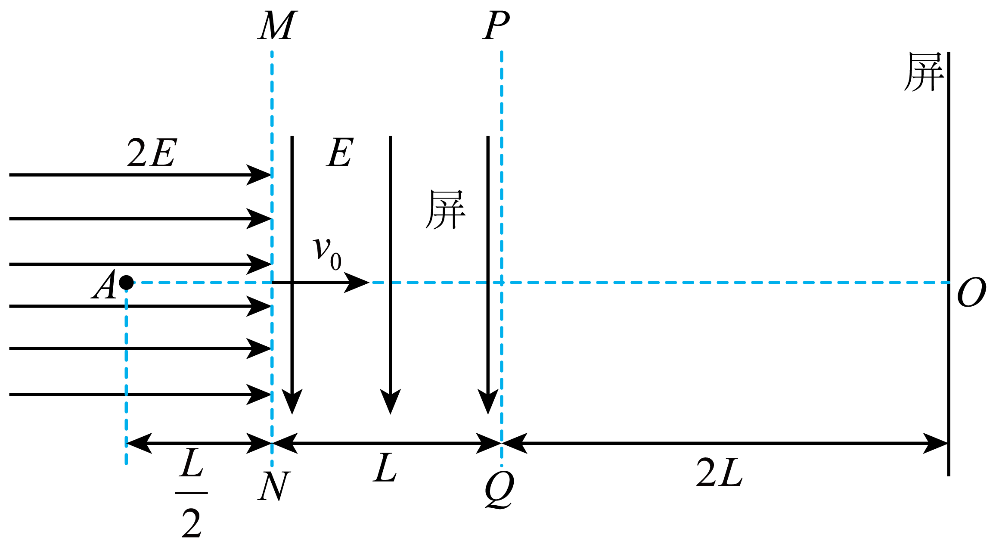

# Physics - 题目 2698

**ID**: f4e14b9c39d44117995b4db5de9d03c0
**年级**: Grade 11
**难度**: Medium-Hard
**题型**: Calculation

## 题目
如图所示，竖直虚线 $MN$ 、 $PQ$ 间距为 $L$ ，在 $MN$ 的左侧有水平向右、大小为 $2E$ 的匀强电场，在 $MN、PQ$ 之间有竖直向下、大小为 $E$ 的匀强电场，在 $PQ$ 右侧 $2L$ 处有一竖直屏。​​​​​​​‌现有一质量为 $m$ 、电荷量为 $+q$ 的粒子，从 $MN$ 左侧 $\frac {L}{2}$ 处的 $A$ 点，由静止释放，粒子以速度 $v{{}_{0}}$ （大小未知）射入 $MN$ 、 $PQ$ 之间的电场中，过 $A$ 点的水平线与屏的交点为O，不计粒子的重力。求：（1） $v{{}_{0}}$ 的大小；（2）粒子从释放到打到屏上所用的时间；（3）打到屏上的点到 $O$ 点的距离。

## 解答

1. （1）粒子在MN左侧运动过程中，根据动能定理可得 $q\times 2E\times \frac {L}{2}=\frac {1}{2}mv{{}_{0}^{2}}$
2. 解得 $v{{}_{0}}=\sqrt {\frac {2qEL}{m}}$
3. （2）粒子在MN左侧运动过程中，根据牛顿第二定律 $q\times 2E=ma{{}_{1}}$
4. 解得 $a{{}_{1}}=\frac {2qE}{m}$
5. 运动时间为 $t{{}_{1}}=\frac {v{{}_{0}}}{a{{}_{1}}}=\sqrt {\frac {{\rm mL}}{2qE}}$
6. 粒子在MN右侧运动过程中，在水平方向上做匀速直线运动，运动时间为 $t{{}_{2}}=\frac {3L}{v{{}_{0}}}=3\sqrt {\frac {{\rm mL}}{2qE}}$
7. 所以，粒子从释放到打到屏上所用的时间为 $t=t{{}_{1}}+t{{}_{2}}=2\sqrt {\frac {2{\rm mL}}{qE}}$
8. （3）粒子在MN、PQ间做类平抛运动，在水平方向 $L=v{{}_{0}}t{{}_{3}}$
9. 在竖直方向，根据牛顿第二定律 $qE=ma{{}_{2}}$ ， $v{{}_{y}}=a{{}_{2}}t{{}_{3}}$ ， $y{{}_{1}}=\frac {v{{}_{y}}}{2}t{{}_{3}}$
10. 粒子在PQ右侧做匀速直线运动，运动时间为 $t{{}_{4}}=\frac {2L}{v{{}_{0}}}$
11. 则竖直位移为 $y{{}_{2}}=v{{}_{y}}t{{}_{4}}$
12. 所以，打到屏上的点到O点的距离为 $y=y{{}_{1}}+y{{}_{2}}$
13. 解得 $y=\frac {5}{4}L$

## 知识点

**中文**:
  - 动能定理的简单应用
  - 带电粒子在匀强电场中的运动

**English**:
  - Simple Applications of Work-Energy Theorem
  - Motion in Uniform Electric Field

---
