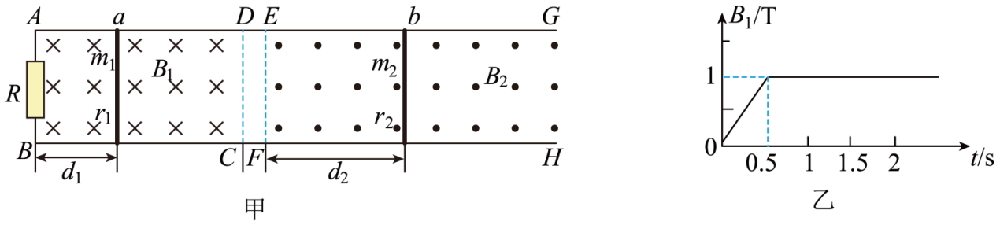

# Physics - 题目 262

**ID**: f616b5ede7be4ca5a340d39c26700112
**年级**: Grade 11
**难度**: Medium-Hard
**题型**: Calculation

## 题目
如图甲所示，水平面上固定着间距为 $L=1{\rm{m}}$ 的两条平行直轨道（除 $DE{\rm{、}}CF$ 是绝缘的连接段外，其他轨道均为不计电阻的导体）， $AB$ 之间有一个 $R=1{\rm{Ω}}$ 的定值电阻， $DC$ 的左侧轨道内分布着竖直向下的匀强磁场 $B{{}_{1}}$ ，该磁场随时间的变化情况如图乙所示， $EF$ 的右侧轨道内分布着垂直导轨平面的匀强磁场，磁感应强度 $B{{}_{2}}=1{\rm{T}}$ ，方向竖直向上、 $t=0$ 时刻，质量 $m{{}_{1}}=1{\rm{k}}{\rm{g}}$ 、电阻 $r{{}_{1}}=1{\rm{Ω}}$ 的a棒静止在距离导轨左侧 $d{{}_{1}}=2{\rm{m}}$ 处，质量 $m{{}_{2}}=2{\rm{k}}{\rm{g}}$ 、电阻 $r{{}_{2}}=0.5{\rm{Ω}}$ 的b棒在距离 $EF$ 右侧 $d{{}_{2}}=4.5{\rm{m}}$ 处被一种特定的装置锁定，两棒均长 $L=1{\rm{m}}$ ，且与轨道接触良好。​​​​​​​‌ $DC$ 左侧的轨道与棒间的动摩擦因数 $μ=0.2$ ， $DC$ 右侧的轨道光滑且足够长，可认为最大静摩擦力等于滑动摩擦力，不考虑轨道连接处的阻碍。 $t=0.5{\rm{s}}$ 时，对a棒施加水平向右 $F=5{\rm{N}}$ 的恒力，在离开 $B{{}_{1}}$ 磁场区域时已达到稳定的速度，过 $DC$ 后撤去恒力。当a棒接触到b棒时，如棒的锁定装置迅速解除，随后两棒碰撞并粘在一起成为一个整体。（1） $t=0.5{\rm{s}}$ 时，通过a棒的电流大小及方向（图中向上或向下）；（2）a棒刚进入 $B{{}_{2}}$ 磁场时，求a棒两端的电势差 $U{{}_{FE}}$ ﹔（3）求b棒在整个过程中产生的焦耳热；（4）a棒、b棒在 $B{{}_{2}}$ 磁场中最终的稳定速度。

## 解答

1. （1） $0-0.5{\rm{s}}$ 内，磁场增强，由楞次定律判断，a棒上的电流方向为向上（逆时针）假设a棒不动 $E=\frac {Δϕ}{Δt}=\frac {ΔB}{Δt}{\rm{s}}=\frac {1}{0.5}\times 1\times 2{\rm{V}}=4{\rm{V}}$ ， $i=\frac {E}{R+r{{}_{1}}}=2A$ ， $F{{}_{A}}=B{{}_{1}}IL=2N$ ，因为最大静摩擦力为 $f{{}_{m}}={\rm μm}{{}_{1}}g=2{\rm{N}}$ ，假设成立，a棒不动。
2. （2）a棒离开 $DC$ 时已达到稳定速度，此时有 $F={\rm μm}{{}_{1}}g+B{{}_{1}}I{{}_{1}}L$ ， $I{{}_{1}}=\frac {B{{}_{1}}Lv{{}_{1}}}{R+r{{}_{1}}}$ ，可得 $v{{}_{1}}=6{\rm{m}}{\rm{/}}{\rm{s}}$a棒以 $v{{}_{1}}=6{\rm{m}}{\rm{/}}{\rm{s}}$ 的速度冲入 $B{{}_{2}}$ 的匀强磁场， $E{{}_{2}}=B{{}_{2}}Lv{{}_{1}}=6{\rm{V}}$a棒两端的电势差为 $U{{}_{FE}}=\frac {E{{}_{2}}}{r{{}_{1}}+r{{}_{2}}}r{{}_{2}}=2{\rm{V}}$
3. （3）考虑a棒进入磁场时，与b棒相距 $d{{}_{2}}=4.5{\rm{m}}$ ﹐a棒在与b棒相撞前，b棒一定处于静止状态，设a棒与b棒碰撞前瞬间的速度为 $v{{}_{2}}$ 。以a棒为研究对象，由动量定理，有
4. $m{{}_{1}}v{{}_{2}}-m{{}_{1}}v{{}_{1}}=-\sum \mathop{B}{{}_{2}}iLΔt=\sum \mathop{\frac {B{{}_{2}^{2}}L{^{2}}}{r{{}_{1}}+r{{}_{2}}}}vΔt=-\frac {B{{}_{2}^{2}}L{^{2}}d{{}_{2}}}{r{{}_{1}}+r{{}_{2}}}$ ，可得a棒在与b棒相撞前的速度为 $v{{}_{2}}=3{\rm{m}}{\rm{/}}{\rm{s}}$ ，由能量守恒定律，从a棒刚进入 $B{{}_{2}}$ 磁场开始到a、b两棒碰撞前瞬间，a棒减少的动能，转化为电能，通过电流做功，释放焦耳热，则 $Q{{}_{b}}=\frac {r{{}_{2}}}{r{{}_{1}}+r{{}_{2}}}Q=\frac {r{{}_{2}}}{r{{}_{1}}+r{{}_{2}}}(\frac {1}{2}m{{}_{1}}v{{}_{1}^{2}}-\frac {1}{2}m{{}_{1}}v{{}_{2}^{2}})$ ，解得 $Q{{}_{b}}=4.5{\rm{J}}$
5. （4）a、b两棒碰撞时，系统动量守恒，最终两棒速度相等 $m{{}_{1}}v{{}_{2}}=\left ({m{{}_{1}}+m{{}_{2}}}\right )v{{}_{{\rm{终}}}}$ ，解得 $v{{}_{{\rm{终}}}}=1{\rm{m}}{\rm{/}}{\rm{s}}$

## 知识点

**中文**:
  - 感生电动势与动生电动势

**English**:
  - Induced EMF vs Motional EMF

---
