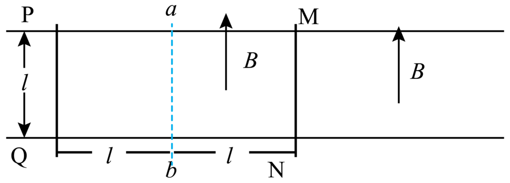

# Physics - 题目 1069

**ID**: f8a610066cc3438bb23d8745d84c77ce
**年级**: Grade 11
**难度**: Medium-Hard
**题型**: Calculation

## 题目
如图所示，一对平行的足够长的光滑金属水平导轨间距为l，与导轨垂直的水平虚线ab右侧的整个空间充满匀强磁场（图中阴影部分），磁感应强度的方向垂直于导轨平面向上，大小为B。​​​​​​​‌在ab左右距离均为l处金属棒PQ和MN都垂直静置于导轨上。在 $t=0{\rm{s}}$ 时，对棒PQ施加水平向右的恒力。已知棒PQ在 $t{{}_{1}}=t{{}_{0}}$ 时刻进入磁场，恰好做匀加速直线运动直到与棒MN相碰，回路的总电阻为R且保持不变。（1）求两棒第一次相碰的时刻 $t{{}_{2}}$ ；（2）若棒PQ的质量是棒MN的一半，求棒PQ的质量 $m{{}_{1}}$ 。

## 解答

1. （1）设恒力为F，PQ刚进入磁场时的速度v_{0}，因PQ进入磁场后做匀加速运动，根据 $a=\frac {F-F{{}_{安}}}{m{{}_{1}}}$ ，可知安培力恒定，根据 $F{{}_{安}}=\frac {B{^{2}}l{^{2}}(v{{}_{PQ}}-v{{}_{MN}})}{R}$ ，可知，两棒速度差恒定，总为 $Δv=v{{}_{PQ}}-v{{}_{MN}}=v{{}_{0}}$ ，因MN只受安培力作用向右加速，安培力恒定，则MN也做匀加速运动，且两棒加速度应该相等，即MN的加速度 $a=a{^{^{′}}}$ ，设再经过时间 ${\rm{Δ}}t$ 两棒相碰，则 $v{{}_{0}}Δt+\frac {1}{2}aΔt{^{2}}=l+\frac {1}{2}a{^{^{′}}}Δt{^{2}}$ ，解得 $Δt=\frac {l}{v{{}_{0}}}=\frac {t{{}_{0}}}{2}$ ，可知两棒第一次相碰的时刻 $t{{}_{2}}=t{{}_{0}}+\frac {t{{}_{0}}}{2}=\frac {3t{{}_{0}}}{2}$
2. （2）设恒力为F，棒PQ的质量 $m{{}_{1}}$ ，则MN的质量为2m_{1}，由题意，PQ运动l进入ab右侧的磁场，则由动量定理 $Ft{{}_{0}}=m{{}_{1}}v{{}_{0}}$ ，由动能定理 $Fl=\frac {1}{2}m{{}_{1}}v{{}_{0}^{2}}$ ，解得 $F=\frac {2lm{{}_{1}}}{t{{}_{0}^{2}}}$ ， $v{{}_{0}}=\frac {2l}{t{{}_{0}}}{\rm ，PQ}$ 的加速度 $a=\frac {F-F{{}_{安}}}{m{{}_{1}}}{\rm ，MN}$ 加速度 $a{^{^{′}}}=\frac {F{{}_{安}}}{2m{{}_{1}}}$ ，则由 $a=a{^{^{′}}}$ ，可得 $m{{}_{1}}=\frac {3B{^{2}}l{^{2}}t{{}_{0}}}{2R}$

## 知识点

**中文**:
  - 双杆模型

**English**:
  - Double Rod Model

---
