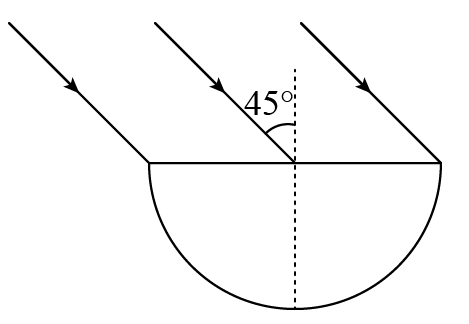

# Physics - 题目 1472

**ID**: fa0dd2260f4f46b1bf0f834b203f10bf
**年级**: Grade 11
**难度**: Medium-Hard
**题型**: Calculation

## 题目
如图所示，一束平行光以45°的入射角照射到半径为R的半圆柱形玻璃砖的上表面上，已知玻璃砖对平行光的折射率为 $\sqrt {2}$①圆柱面上光线能够射出的区域所对的圆心角θ是多少?②能从圆柱面射出的光线中，在玻璃砖中传播时间最长为多少?(光在真空中的速度为c）​​​​​​​‌

## 解答

1. ①作出光路图，如图所示
2. 
3. 由折射定律得
4. $n=\frac {{\sin}i}{{\sin}r}$
5. 解得
6. $r=30{}^\circ $
7. 如果光线EA刚好在A点发生全反射，则有
8. ${\sin}\angle EAO=\frac {1}{n}$
9. 解得
10. $\angle EAO=45{}^\circ $
11. $\angle EOA=180{}^\circ -45{}^\circ -60{}^\circ =75{}^\circ $
12. 因EA与OB平行，所以
13. $\angle AOB=\angle EAO=45{}^\circ $
14. 如果光线FC刚好在C点发生全反射，则有
15. $\angle FCO=45{}^\circ $
16. $\angle FOC=180{}^\circ -120{}^\circ -45{}^\circ =15{}^\circ $
17. 故知圆柱面上光线能够射出的区域所对的圆心角为
18. $θ=180{}^\circ -\angle EOA-\angle FOC=180{}^\circ -75{}^\circ -15{}^\circ =90{}^\circ $
19. ②能从圆柱面射出的光线中，射向圆心的光线在玻璃砖中传播的最长距离
20. $s=R$
21. 光线在玻璃砖中传播的速度
22. $v=\frac {c}{n}$
23. 光线在玻璃砖中传播的最长时间
24. $t=\frac {s}{v}$
25. 解得
26. $t=\frac {\sqrt {2}R}{c}$

## 知识点

**中文**:
  - 光的折射定律及其应用

**English**:
  - Law of Refraction and Applications

---
