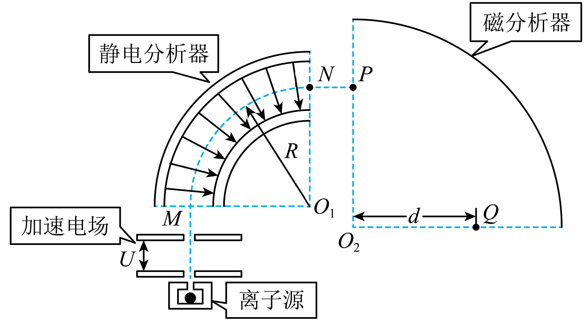

# Physics - 题目 555

**ID**: fa5b3ebb9be341df92cc4ba74d38ba4a
**年级**: Grade 11
**难度**: Medium-Hard
**题型**: Calculation

## 题目
有一种“双聚焦分析器”质谱仪，工作原理如图所示。​​​​​​​‌加速电场的电压为U，静电分析器中有会聚电场，即与圆心O_{1}等距各点的电场强度大小相同，方向沿径向指向圆心O_{1}，磁分析器中以O_{2}为圆心、圆心角为90°的扇形区域内，分布着方向垂直于纸面向外的匀强磁场，其左边界与静电分析器的右边界平行。由离子源发出一个质量为m、电荷量为q的正离子（初速度为零，重力不计）；经加速电场加速后，从M点沿垂直于该点的电场方向进入静电分析器，在静电分析器中，离子沿半径为R的四分之一圆弧轨道做匀速圆周运动，并从N点射出静电分析器。而后离子由P点沿着既垂直于磁分析器的左边界，又垂直于磁场方向射入磁分析器中，最后离子沿垂直于磁分析器下边界的方向从Q点射出，并进入收集器，测量出Q点与圆心O_{2}的距离为d。（题中的U、m、q、R、d都为已知量）（1）求静电分析器中离子运动轨迹处电场强度E的大小；（2）求磁分析器中磁感应强度B的大小；（3）现将离子换成质量为2m，电荷量为0.5q的另一种正离子，其它条件不变。磁分析器空间足够大，离子不会从圆弧边界射出，求：该离子进入磁分析器的位置P′以及离开磁分析器的位置Q′到O_{2}的距离。

## 解答

1. （1）根据动能定理 $qU=\frac {1}{2}mv{^{2}}$
2. 离子在静电分析器中做匀速圆周运动，则 $qE=m\frac {v{^{2}}}{R}$
3. 联立得 $E=\frac {2U}{R}$
4. （2）离子垂直磁分析器左边界进入，垂直下边界射出，则离子在磁分析器中圆周运动的半径为d，则 $qvB=m\frac {v{^{2}}}{d}$
5. 得 $B=\frac {1}{d}\sqrt {\frac {2Um}{q}}$
6. （3）由（1）可得，另一种离子在静电分析器中的运动半径仍为R，所以该离子进入磁分析器的位置P′仍为P，由 $0.5qU=\frac {1}{2}\cdot 2mv^{′}{{^{2}}}$
7. 得 $v^{′}=\sqrt {\frac {qU}{2m}}$
8. 在磁分析器中 $0.5qv^{′}B=2m\frac {v^{′}{{^{2}}}}{r^{′}}$
9. 得 $r^{′}=2d$
10. 该离子离开磁分析器的位置Q′到O_{2}的距离为 $x=\sqrt {{\left({2d}\right)^{2}}-{\left({2d-d}\right)^{2}}}=\sqrt {3}d$

## 知识点

**中文**:
  - 带电粒子在匀强磁场中的运动
  - 带电粒子的运动半径和周期公式及其简单应用
  - 带电粒子在有界匀强磁场中的运动

**English**:
  - Motion of Charged Particles in Uniform Magnetic Field
  - Radius and Period Formulas and Applications
  - Motion in Bounded Uniform Magnetic Field

---
