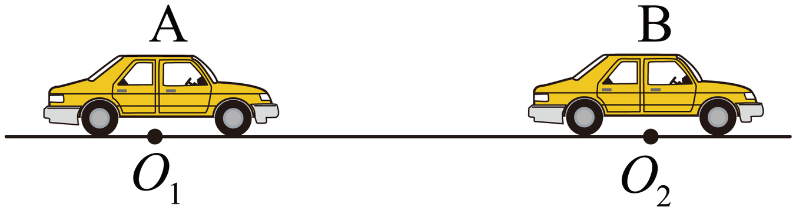

# Physics - 题目 2152

**ID**: fd50a79fccfc4915b2fbb25822d79ebc
**年级**: Grade 11
**难度**: Medium-Hard
**题型**: Calculation

## 题目
某学校科学探究小组为探究蓝牙设备的有效通信问题，通过实验测试发现两蓝牙设备通信的最远距离 $s{{}_{0}}=16{\rm{m}}$ 。​​​​​​​‌该探究小组用安装有蓝牙设备的汽车A、B进一步研究运动中的通信时间问题。如图，开始时，A、B两车处于同一平直路段上的两点 $O{{}_{1}}$ 、 $O{{}_{2}}{\rm ，A}$ 车从 $O{{}_{1}}$ 点由静止开始启动，以加速度 $a{{}_{1}}=2{\rm{m}}/{\rm{s}}{^{2}}$ 向右做匀加速运动，与此同时B车从 $O{{}_{2}}$ 点正以初速度 $v{{}_{2}}=4{\rm{m}}/{\rm{s}}$ 、加速度 $a{{}_{2}}=1{\rm{m}}/{\rm{s}}{^{2}}$ 向右做匀加速运动，此时两车相距 $d=8{\rm{m}}$ 。忽略信号传递的时间，两小车可视为质点，相遇时擦肩而过，不会相撞。求：（1）A、B两车相遇前的最大距离；（2）A、B两车能保持通信的最长时间；（3）若两车运动的最大速度为 $20{\rm{m}}/{\rm{s}}$ ，达到最大速度后均做匀速直线运动，则A、B之间最后所保持的距离及在B车速度达到最大前A、B两车能保持通信的时间。

## 解答

1. （1）两车速度相等时，由运动学公式可得 $a{{}_{1}}t{{}_{1}}=v{{}_{2}}+a{{}_{2}}t{{}_{1}}$
2. 解得两车运动时间 $t{{}_{1}}=4{\rm{s}}$
3. 此时两车相遇前相距最远，大小为 $x{{}_{1}}=v{{}_{2}}t{{}_{1}}+\frac {1}{2}a{{}_{2}}t{{}_{1}^{2}}+d-\frac {1}{2}a{{}_{1}}t{{}_{1}^{2}}$
4. 解得 $x{{}_{1}}=16{\rm{m}}$
5. （2）由于两车相遇前最大距离为16m，则A车从开始到在B车前16m处这个过程中一直保持通信，设通信时间为 $t{{}_{2}}$ ，根据运动学公式可得 $\frac {1}{2}a{{}_{1}}t{{}_{2}^{2}}-\left ({v{{}_{2}}t{{}_{2}}+\frac {1}{2}a{{}_{2}}t{{}_{2}^{2}}+d}\right )=s{{}_{0}}$
6. 代入数据可得 $t{{}_{2}}=12{\rm{s}}$
7. （3）已知 $v{{}_{{\rm{m}}}}=20{\rm{m}}/{\rm{s}}$ ，当A、B两车分别达到最大速度时，所用时间分别为 $t{{}_{{\rm{A}}}}=\frac {v{{}_{{\rm{m}}}}}{a{{}_{1}}}=10{\rm{s}}$ ， $t{{}_{{\rm{B}}}}=\frac {v{{}_{{\rm{m}}}}-v{{}_{2}}}{a{{}_{2}}}=16{\rm{s}}$
8. 16s内A车所走位移大小 $x{{}_{{\rm{A}}}}=\frac {1}{2}a{{}_{1}}t{{}_{{\rm{A}}}^{2}}+v{{}_{{\rm{m}}}}\left ({t{{}_{{\rm{B}}}}-t{{}_{{\rm{A}}}}}\right )=220{\rm{m}}$
9. 16s内B车所走位移大小 $x{{}_{{\rm{B}}}}=v{{}_{2}}t{{}_{{\rm{B}}}}+\frac {1}{2}a{{}_{2}}t{{}_{{\rm{B}}}^{2}}=192{\rm{m}}$
10. 则A、B之间最后所保持的距离，且A车在B前 $x=x{{}_{{\rm{A}}}}-\left ({x{{}_{{\rm{B}}}}+d}\right )=20{\rm{m}}$
11. 综上，设在B车速度达到最大前A、B两车能保持通信的时间为 $t{{}_{3}}$ ，则有 $\frac {1}{2}a{{}_{1}}t{{}_{{\rm{A}}}^{2}}+v{{}_{{\rm{m}}}}\left ({t{{}_{3}}-t{{}_{{\rm{A}}}}}\right )-\left ({v{{}_{2}}t{{}_{3}}+\frac {1}{2}a{{}_{2}}t{{}_{3}^{2}}+d}\right )=s{{}_{0}}$
12. 解得 $t{{}_{3}}=(16-2\sqrt {2}){\rm{s}}$ ， $t{{}_{3}}=(16+2\sqrt {2}){\rm{s}}$ （舍去）。

## 知识点

**中文**:
  - 追及与相遇问题

**English**:
  - Chase and Encounter Problems

---
