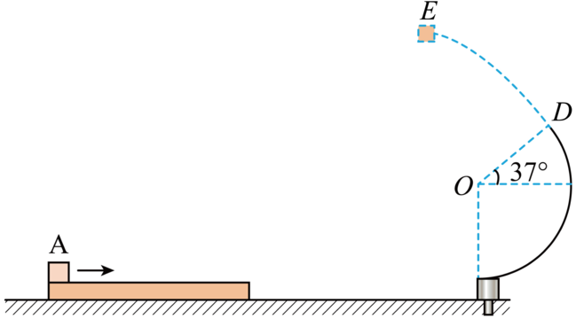

# Physics - 题目 2584

**ID**: fd8b46bb2a794acab989c6358025325b
**年级**: Grade 11
**难度**: Medium-Hard
**题型**: Calculation

## 题目
如图，质量为 $1{\rm{k}}{\rm{g}}$ 的薄木板静置于光滑水平地面上，半径为 $R=0.75{\rm{m}}$ 的竖直光滑圆弧轨道固定在地面，轨道底端与木板等高，轨道上端点和圆心连线与水平面成37°角。​​​​​​​‌质量为 $2{\rm{k}}{\rm{g}}$ 的小物块A以 ${{8}}{\rm{m}}/{\rm{s}}$ 的初速度从木板左端水平向右滑行，A与木板间的动摩擦因数为0.5。当A到达木板右端时，木板恰好与轨道底端相碰并被锁定，同时A沿圆弧切线方向滑上轨道。已知木板长度为 $1.3{\rm{m}}{\rm ，\mathit{g}}$ 取 $10{\rm{m}}/{\rm{s}}{^{2}}$ ， $\sqrt {10}$ 取3. ${\rm 16，}\sin 37\mathrm{°}=0.6$ ， ${\cos}37\mathrm{°}=0.8$ 。（1）求木板与轨道底端碰撞前瞬间，物块A和木板的速度大小；（2）求物块A到达圆弧轨道最高点时受到轨道的弹力大小及离开轨道后距地面的最大高度；（3）物块A运动到最大高度时会炸裂成质量比为1:3的物块B和物块C，总质量不变，同时系统动能增加 $3{\rm{J}}$ ，已知两物块都沿原速度方向运动.问炸裂后的物块B和C能否落在木板上。

## 解答

1. （1）设物块A的初速度为 $v{{}_{0}}$ ，木板与轨道底部碰撞前，物块A和木板的速度分别为 $v{{}_{1}}$ 和 $v{{}_{2}}$ ，物块A和木板的质量分别为 $m{{}_{1}}$ 和 $m{{}_{2}}$ ，物块A与木板间的动摩擦因数为 $μ$ ，木板长度为L，由动量守恒定律和功能关系有 $m{{}_{1}}v{{}_{0}}=m{{}_{1}}v{{}_{1}}+m{{}_{2}}v{{}_{2}}$ ， $\frac {1}{2}m{{}_{1}}v{{}_{0}^{2}}=\frac {1}{2}m{{}_{1}}v{{}_{1}^{2}}+\frac {1}{2}m{{}_{2}}v{{}_{2}^{2}}+{\rm μm}{{}_{1}}gL$ ，由题意分析 $v{{}_{1}}⩾v{{}_{2}}$ ，联立式得 $v{{}_{1}}=7{\rm{m}}/{\rm{s}}$ ， $v{{}_{2}}=2{\rm{m}}/{\rm{s}}$
2. （2）设圆弧轨道半径为R，物块A到圆弧轨道最高点时斜抛速度为 $v{{}_{3}}$ ，轨道对物块的弹力为 ${F}_{\mathrm{N}}$ ，物块A从轨道最低点到最高点，根据动能定理有 $-m{{}_{1}}gR\left ({1+\sin 37{}\degree }\right )=\frac {1}{2}m{{}_{1}}v{{}_{3}^{2}}-\frac {1}{2}m{{}_{1}}v{{}_{1}^{2}}$ ，物块A到达圆弧轨道最高点时，根据牛顿第二定律有 $F{{}_{{\rm{N}}}}+m{{}_{1}}g\sin 37{}\degree =m{{}_{1}}\frac {v{{}_{3}^{2}}}{R}$ ，联立式，得 $F{{}_{{\rm{N}}}}=\frac {164}{3}{\rm{N}}$ ，设物块A抛出时速度 $v{{}_{3}}$ 的水平和竖直分量分别为 ${v}_{x}$ 和 $v{{}_{y}}$ ， $v{{}_{x}}=v{{}_{3}}\sin 37{}\degree $ ， $v{{}_{y}}=v{{}_{3}}{\cos}37{}\degree $ ，斜抛过程物块A上升时间 $t{{}_{1}}=\frac {v{{}_{y}}}{g}=0.4{\rm{s}}$ ，该段时间物块A向左运动距离为 $s{{}_{1}}=v{{}_{x}}t{{}_{1}}=1.2{\rm{m}}$ ，物块A距离地面最大高度 $H=R\left ({1+\sin 37{}\degree }\right )+\frac {v{{}_{y}^{2}}}{2g}=2{\rm{m}}$
3. （3）物块A从最高点落地时间 $t{{}_{2}}=\sqrt {\frac {2H}{g}}=0.632{\rm{s}}$ ，设向左为正方向，物块A在最高点炸裂为B、C，设质量和速度分别为 $m{{}_{3}}$ 、 $m{{}_{4}}$ 和 $v{{}_{4}}$ 、 $v{{}_{5}}$ ，设 $m{{}_{3}}:m{{}_{4}}=1:3$ ，系统动能增加 $ΔE{{}_{{\rm{k}}}}$ ，根据动量守恒定律和能量守恒定律得 $m{{}_{1}}v{{}_{x}}=m{{}_{3}}v{{}_{4}}+m{{}_{4}}v{{}_{5}}$ ， $\frac {1}{2}m{{}_{1}}v{{}_{x}^{2}}+{\rm{Δ}}E{{}_{{\rm{k}}}}=\frac {1}{2}m{{}_{3}}v{{}_{4}^{2}}+\frac {1}{2}m{{}_{4}}v{{}_{5}^{2}}$ ，解得 $v{{}_{4}}=6{\rm{m}}/{\rm{s}}$ ， $v{{}_{5}}=2{\rm{m}}/{\rm{s}}$ 或 $v{{}_{4}}=0$ ， $v{{}_{5}}=4{\rm{m}}/{\rm{s}}$ （舍去），炸裂后C落地过程中的水平位移为 $s{{}_{2}}=v{{}_{5}}t{{}_{2}}=1.264{\rm{m}}$ ，距木板右端距离 $s{{}_{2}}=v{{}_{5}}t{{}_{2}}+x{{}_{OE}}=1.864{\rm{m}}$ ，不会落在木板上

## 知识点

**中文**:
  - 动量守恒与曲线运动相结合
  - 动量守恒与板块模型相结合
  - 动量守恒中的临界问题

**English**:
  - Momentum Conservation with Curvilinear Motion
  - Momentum Conservation with Plate Models
  - Critical Problems in Momentum Conservation

---
