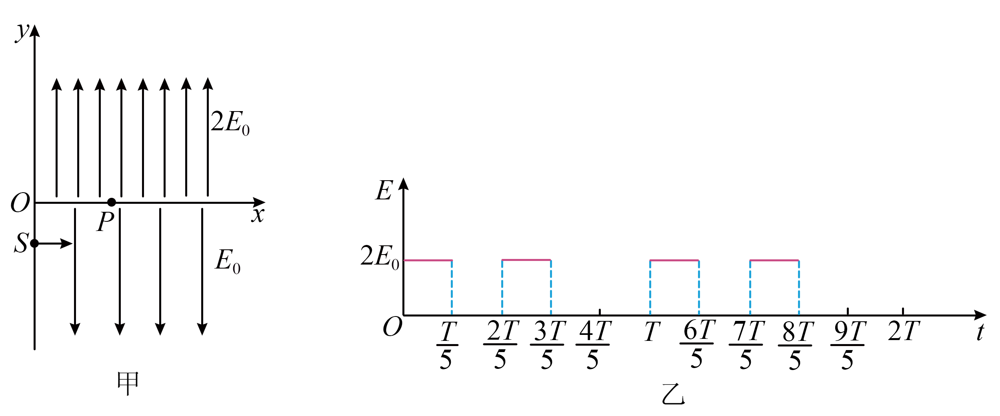

# Physics - 题目 837

**ID**: ff8c15a7fa11498e8a77dd057459f1a1
**年级**: Grade 11
**难度**: Medium-Hard
**题型**: Calculation

## 题目
在科学研究中，常用电场来控制带电粒子的运动轨迹。​​​​​​​‌如图甲，真空环境中，平面直角坐标系 $xOy$ 的第一、四象限内分别存在沿 $y$ 轴正、负方向的匀强电场，电场强度的大小分别为 $2E{{}_{0}}、E{{}_{0}}$ （均未知），一电子从 $y$ 轴负半轴上的 $\mathrm{S}$ 点以大小为 $v{{}_{0}}$ 的速度沿 $x$ 轴正方向射入第四象限，经电场偏转后，从 $x$ 轴上的 $P$ 点第一次通过 $x$ 轴进入第一象限。已知电子的质量为 $m$ 、电荷量为 $e{\rm ，\mathit{S}}$ 点、 $P$ 点的坐标分别为 $(0,-L)$ 、 $(2L,0)$ ，不计电子的重力。求：（1）第四象限内匀强电场的电场强度 $E{{}_{0}}$ 的大小；（2）该电子第二次通过 $x$ 轴时的坐标；（3）若从电子第一次通过 $x$ 轴进入第一象限时开始计时，第一象限中的电场按图乙所示的规律周期性变化，其中 $0\sim \frac {T}{5}$ 和 $\frac {2T}{5}\sim \frac {3T}{5}$ ，电场强度的大小均为 $2E{{}_{0}}$ 、方向沿 $y$ 轴正方向， $\frac {T}{5}\sim \frac {2T}{5}$ 和 $\frac {3T}{5}\sim T$ 内撤去电场，已知 $T=\frac {5L}{2v{{}_{0}}}$ ，则电子第三次通过 $x$ 轴的位置坐标为多少？

## 解答

1. （1）在第四象限，根据牛顿第二定律 $eE{{}_{0}}=ma{{}_{1}}$
2. 电子在第四象限做类平抛运动，沿x轴方向 $2L=v{{}_{0}}t{{}_{1}}$
3. 沿y轴方向 $L=\frac {1}{2}a{{}_{1}}t{{}_{1}^{2}}$
4. 解得 $E{{}_{0}}=\frac {mv{{}_{0}^{2}}}{2eL}$
5. （2）电子从x轴上的P点第一次通过x轴时，沿y轴方向 $v{{}_{y1}}=a{{}_{1}}t{{}_{1}}$
6. 解得 $v{{}_{y1}}=v{{}_{0}}$
7. 所以电子从x轴上的P点第一次通过x轴时，与x轴正方向的夹角为 $45{}\degree $ ，在第一象限，电子沿y轴正方向先做匀减速，速度减为零后反向加速，第二次回到x轴，在第一象限，根据牛顿第二定律 $e\times 2E{{}_{0}}=ma{{}_{2}}$
8. 沿y轴方向 $v{{}_{y1}}-(-v{{}_{y1}})=a{{}_{2}}t{{}_{2}}$
9. 沿x轴方向 $x{{}_{2}}=v{{}_{0}}t{{}_{2}}$
10. 解得 $x{{}_{2}}=2L$
11. 电子第二次通过x轴时的坐标为 $(4L,0)$ ；
12. （3）从电子第一次通过x轴进入第一象限时开始计时，沿y轴方向 $0\sim \frac {T}{5}$ ，电子向上做减速运动，根据牛顿第二定律可知，粒子在第一象限内的加速度大小仍为 $a{{}_{2}}$ ，在 $t=\frac {T}{5}$ 时，沿y轴方向，电子的速度大小为 $v{{}_{y2}}=v{{}_{y1}}-a{{}_{2}}\times \frac {T}{5}=\frac {1}{2}v{{}_{0}}$
13. $\frac {T}{5}\sim \frac {2T}{5}$ ，电场强度为0，沿y轴方向，电子做匀速直线运动； $\frac {2T}{5}\sim \frac {3T}{5}$ ，沿y轴方向，电子继续做匀减速直线运动； $t=\frac {3T}{5}$ 时，沿y轴方向，电子的速度大小为 $v{{}_{y3}}=v{{}_{y2}}-a{{}_{2}}\times \frac {T}{5}=0$
14. $\frac {3T}{5}\sim T$ ，电子沿y轴方向的分速度为0，所以沿x轴方向做匀速直线运动；根据运动的对称性，可知 $t=\frac {8T}{5}$ 时，电子第二次回到x轴，之后电子以与x轴成 $45{}\degree $ 的方向斜射入第四象限，粒子在第四象限运动时间 $t{{}_{3}}=\frac {2v{{}_{y1}}}{a{{}_{1}}}$
15. $t{{}_{3}}$ 时间内，电子在第四象限内沿x轴的位移 $x=v{{}_{0}}t{{}_{3}}$
16. 从电子第一次经过x轴至第三次经过x轴，沿水平方向上的位移为 $x{{}_{总}}=\frac {8T}{5}\times v{{}_{0}}+x=8L$
17. 此时的位置坐标为 $(10L,0)$ 。

## 知识点

**中文**:
  - 带电粒子在交变电场中的运动

**English**:
  - Motion in Alternating Electric Field

---
