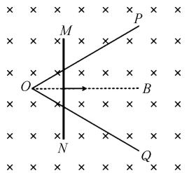

# Physics - 题目 2509

**ID**: ffacc875ad5143799461ce7c6695a8ab
**年级**: Grade 11
**难度**: Medium-Hard
**题型**: Calculation

## 题目
如图所示，“V”形导轨沿水平方向固定， $\angle POQ=60{}\degree ,OB$ 为 $\angle POQ$ 的角平分线。​​​​​​​‌在整个空间加竖直向下的匀强磁场，磁感应强度大小为 $B{{}_{0}}=2{\rm{T}}$ ，导体棒 $MN$ 垂直 $OB$ 放置在 $O$ 点，从 $t=0$ 时刻开始导体棒向右以恒定的速度 $v=0.5{\rm{m}}/{\rm{s}}$ 运动，导体棒始终与 $OB$ 垂直且始终保持与导轨有良好的接触，从 $t=1{\rm{s}}$ 开始空间的磁感应强度随时间的变化规律为 $B=\left ({0.2t+1.8}\right )T\left ({t⩾1{\rm{s}}}\right )$ 。求：(1) $t=1{\rm{s}}$ 时穿过闭合回路的磁通量；(2) $t=2{\rm{s}}$ 到 $t=5{\rm{s}}$ 时穿过回路磁通量的变化量；(3)若 $t=1{\rm{s}}$ 开始，欲使回路中没有感应电流产生，写出从 $t=1{\rm{s}}$ 开始磁感应强度随时间的变化规律。

## 解答

1. （1）导体棒 $MN$ 向右匀速运动，1s内的位移为
2. $x{{}_{1}}=vt{{}_{1}}=0.5\times 1{\rm{m}}=0.5{\rm{m}}$
3. 有几何关系可知导体棒接在导轨间的长度为
4. $L{{}_{1}}=\frac {x{{}_{1}}}{{\cos}30{}\degree }$
5. 解得
6. $L{{}_{1}}=\frac {\sqrt {3}}{3}{\rm{m}}$
7. 闭合回路围成的面积为
8. $S{{}_{1}}=\frac {1}{2}x{{}_{1}}L{{}_{1}}$
9. 解得
10. $S{{}_{1}}=\frac {\sqrt {3}}{12}{\rm{m}}{^{2}}$  $t=1{\rm{s}}$ 时穿过闭合回路的磁通量大小为
11. ${\rm{Φ}}{{}_{1}}=B{{}_{0}}S{{}_{1}}$
12. 解得
13. ${\rm{Φ}}{{}_{1}}=\frac {\sqrt {3}}{6}{\rm{W}}{\rm{b}}$
14. （2） $0\sim 2{\rm{s}}$ 导体棒的位移为
15. $x{{}_{2}}=vt{{}_{2}}=1{\rm{m}}$
16. 由几何关系可知导体棒接在导轨间的长度为
17. $L{{}_{2}}=\frac {x{{}_{2}}}{{\cos}30{}\degree }$
18. 解得
19. $L{{}_{2}}=\frac {2\sqrt {3}}{3}{\rm{m}}$
20. 闭合回路围成的面积为
21. $S{{}_{2}}=\frac {1}{2}x{{}_{2}}L{{}_{2}}$
22. 解得
23. $S{{}_{2}}=\frac {\sqrt {3}}{3}{\rm{m}}{^{2}}$  $t=2{\rm{s}}$ 时的磁感应强度为
24. $B{{}_{2}}=\left ({0.2\times 2+1.8}\right ){\rm{T}}=2.2{\rm{T}}$  $t=2{\rm{s}}$ 时穿过闭合回路的磁通量大小为
25. ${\rm{Φ}}{{}_{2}}=B{{}_{2}}S{{}_{2}}$
26. 解得
27. ${\rm{Φ}}{{}_{2}}=\frac {11\sqrt {3}}{15}{\rm{W}}{\rm{b}}$  $0\sim 5{\rm{s}}$ 导体棒的位移为
28. $x{{}_{3}}=vt{{}_{3}}=2.5{\rm{m}}$
29. 由几何关系可知导体棒接在导轨间的长度为
30. $L{{}_{3}}=\frac {x{{}_{3}}}{{\cos}30{}\degree }$
31. 解得
32. $L{{}_{3}}=\frac {5\sqrt {3}}{3}{\rm{m}}$
33. 闭合回路围成的面积为
34. $S{{}_{3}}=\frac {1}{2}x{{}_{3}}L{{}_{3}}=\frac {25\sqrt {3}}{12}{\rm{m}}{^{2}}$  $t=5{\rm{s}}$ 时的磁感应强度为
35. $B{{}_{3}}=\left ({0.2\times 5+1.8}\right ){\rm{T}}=2.8{\rm{T}}$  $t=5{\rm{s}}$ 时穿过闭合回路的磁通量大小为
36. ${\rm{Φ}}{{}_{3}}=B{{}_{3}}S{{}_{3}}=\frac {35\sqrt {3}}{6}{\rm{W}}{\rm{b}}$  $t=2{\rm{s}}$ 到 $t=5{\rm{s}}$ 时穿过回路的磁通量的变化量
37. ${\rm{Δ}}{\rm{Φ}}={\rm{Φ}}{{}_{3}}-{\rm{Φ}}{{}_{2}}=\frac {51\sqrt {3}}{10}{\rm{W}}{\rm{b}}$
38. （3）欲使回路中没有感应电流产生，则穿过回路的磁通量保持不变，即回路中的磁通量始终等于 $t=1{\rm{s}}$ 时的磁通量，即为
39. ${\rm{Φ}}{{}_{1}}=\frac {\sqrt {3}}{6}{\rm{W}}{\rm{b}}$
40. 使 $t$ 时间内导体棒的位移为
41. $x=vt=\frac {1}{2}t$  $t$ 时导体棒接在导轨间的长度为
42. $L=\frac {x}{{\rm{c}}{\rm{o}}{\rm{s}}30{}\degree }=\frac {\sqrt {3}}{3}t$  $t$ 时闭合回路围成的面积为
43. $S=\frac {1}{2}xL=\frac {\sqrt {3}}{12}t{^{2}}$  $t$ 时穿过回路的磁通量为
44. ${\rm{Φ}}=BS=\frac {\sqrt {3}}{12}Bt{^{2}}$
45. 欲满足条件，应有
46. ${\rm{Φ}}={\rm{Φ}}{{}_{1}}$
47. 解得
48. $B=\frac {2}{t{^{2}}}{\rm{W}}{\rm{b}}\left ({t⩾1{\rm{s}}}\right )$

## 知识点

**中文**:
  - 电磁感应定律的应用

**English**:
  - Applications of Faraday's Law

---
