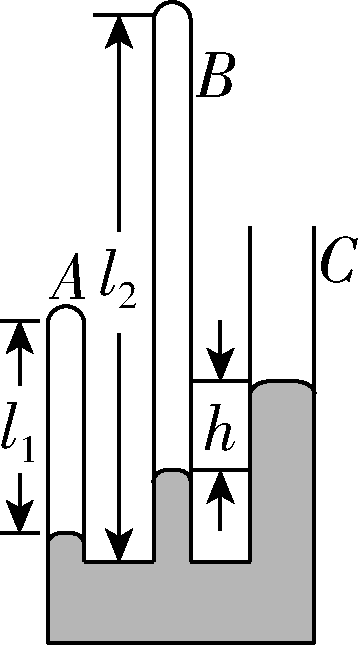

# Physics - 题目 2731

**ID**: 1f9e8275e48d41ea83ae9c6b24cdf963
**年级**: Grade 11
**难度**: Medium-Hard
**题型**: 刷真题

## 题目
如图，一玻璃装置放在水平桌面上，竖直玻璃管A、B、C粗细均匀，A、B两管的上端封闭，C管上端开口，三管的下端在同一水平面内且相互连通．A、B两管的长度分别为l_{1}＝13.​​​​​​​‌5 cm，l_{2}＝32 cm.将水银从C管缓慢注入，直至B、C两管内水银柱的高度差h＝5 cm.已知外界大气压为p_{0}＝75 cmHg.求A、B两管内水银柱的高度差．

## 解答

1. 以B中气体为研究对象，设初状态压强为p_{B}，体积为V_{B}，B管横截面积为S，
2. 初状态p_{B}＝p_{0}，V_{B}＝l_{2}S，
3. 设末状态压强为p′_{B}，体积为V′_{B}，
4. p′_{B}＝p_{0}＋p_{h}＝75 cmHg＋5 cmHg＝80 cmHg，
5. V′_{B}＝l′_{2}S，
6. 由于水银从C管缓慢注入，整个过程管内气体发生等温变化，
7. 由玻意耳定律得p_{B}V_{B}＝p′_{B}V′_{B}，
8. 解得l′_{2}＝30 cm；
9. 以A中气体为研究对象，设初状态压强为p_{A}，体积为V_{A}，A管横截面积为S′，
10. 初状态p_{A}＝p_{0}，V_{A}＝l_{1}S′，
11. 设末状态压强为p′_{A}，体积为V′_{A}＝l′_{1}S′，
12. 由题图中液柱关系可得A中水银柱高为l_{1}－l′_{1}，
13. C中水银柱高为h＋(l_{2}－l′_{2})＝7 cm，
14. 则A中气体末状态压强p′_{A}＝(l′_{1}＋68.5) cmHg，
15. 整个过程管内气体发生等温变化，由玻意耳定律有p_{A}V_{A}＝p′_{A}V′_{A}，
16. 解得l′_{1}＝12.5 cm，
17. 设A、B两管内水银柱的高度差为Δh，则
18. Δh＝(l_{2}－l′_{2})－(l_{1}－l′_{1})＝1 cm.

## 知识点

**中文**:
  - 气体等温变化与玻意耳定律

**English**:
  - Isothermal Change and Boyle's Law

---
