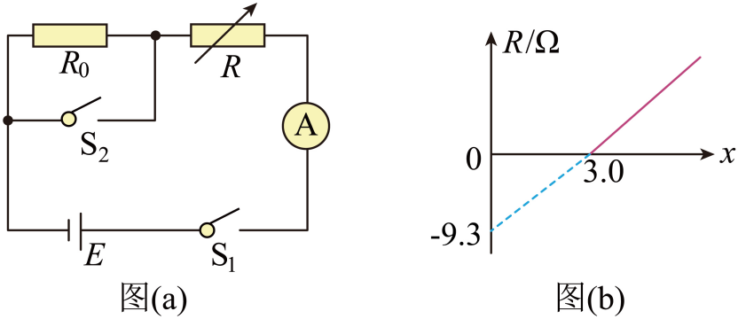
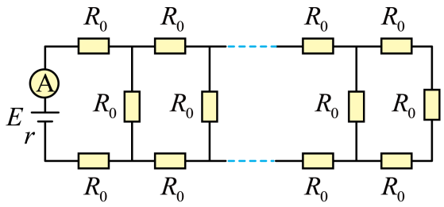

# Physics - 题目 2232

**ID**: 26776f3b4b4445d3a8545567e669c69e
**年级**: Grade 11
**难度**: Medium-Hard
**题型**: Experiment

## 题目
某同学利用如图（a）所示的电路测量未知电阻 $R{{}_{0}}$ 的阻值与电源电动势E和内阻r，R为电阻箱，电流表可视为理想电流表。​​​​​​​‌操作步骤如下：(1)测量 $R{{}_{0}}$ 的阻值。先闭合开关 ${\rm{S}}{{}_{{{1}}}}$ 和 ${\rm{S}}{{}_{{{2}}}}$ ，调节电阻箱，当电阻箱的阻值R为11Ω时，电流表示数为I；接着断开 ${\rm{S}}{{}_{{{2}}}}$ ，调节电阻箱，当电阻箱的阻值R为5Ω时，电流表示数仍为I，此时则 $R{{}_{0}}$ 的阻值为Ω；若电流表为非理想电流表，则按照该方法实际测量得到的 $R{{}_{0}}$ 的阻值将（选填“偏大”“偏小”或者“不变”）。(2)保持 ${\rm{S}}{{}_{{{1}}}}$ 闭合、 ${\rm{S}}{{}_{{{2}}}}$ 断开，多次调节电阻箱的阻值，记录每次调节后的电阻箱的阻值R及电流表A的示数I。为了直观地得到I与R的关系，该同学以电阻箱的阻值R为纵轴，以x为横轴作出了如图（b）的图像，则横轴x为， $R=$（均选用字母E、I、 $R{{}_{0}}$ 和r表示）。(3)若图（b）中横轴x所表示的物理量的单位为国际单位，由图像可求得电源的电动势 $E=$V，内阻 $r=$$Ω$ （结果均保留2位有效数字）。(4)设想用该电源和理想电流表以及无数个电阻 $R{{}_{0}}$ 构成一个电路，则电流的示数为A。（结果保留2位有效数字）

## 解答

1. （1）[1]先闭合开关 ${\rm{S}}{{}_{{{1}}}}$ 和 ${\rm{S}}{{}_{{{2}}}}$ ，调节电阻箱，当电阻箱的阻值R为 $R{{}_{1}}=11Ω$ 时，电流表示数为I，根据闭合电路欧姆定律有 $I=\frac {E}{R{{}_{1}}+r}$ ，断开 ${\rm{S}}{{}_{{{2}}}}$ ，调节电阻箱，当电阻箱的阻值R为 $R{{}_{2}}=5Ω$ 时，电流表示数仍为I，根据闭合电路欧姆定律有 $I=\frac {E}{R{{}_{0}}+R{{}_{2}}+r}$ ，解得 $R{{}_{0}}=R{{}_{1}}-R{{}_{2}}=6Ω$
2. [2]根据上述结论可知，待测电阻的阻值与电流表的内阻无关，则若电流表为非理想电流表，则按照该方法实际测量得到的R的阻值将不变。
3. （2）[1][2]保持 ${\rm{S}}{{}_{{{1}}}}$ 闭合、 ${\rm{S}}{{}_{{{2}}}}$ 断开，多次调节电阻箱的阻值，根据闭合电路欧姆定律有 $I=\frac {E}{R{{}_{0}}+R+r}$ ，整理得 $R=\frac {E}{I}-R{{}_{0}}-r$ ，则横轴x为 $\frac {1}{I}$ ，纵轴y为 $R=\frac {E}{I}-R{{}_{0}}-r$ .
4. （3）[1][2]根据上述图像函数表达式可知，图像斜率表示电动势 $E$ ，则有 $E=\frac {9.3}{3.0}{\rm{V}}=3.1{\rm{V}}$ ，根据图像截距有 $-R{{}_{0}}-r=-9.3Ω$ ，解得 $r=3.3Ω$
5. （4）设虚线框内电阻为R，则 $R=2R{{}_{0}}+\frac {R{{}_{0}}R}{R{{}_{0}}+R}$ ，解得 $R=(1+\sqrt {3})R{{}_{0}}$ ，则电流表读数为 $I=\frac {E}{r+R}=\frac {3.1}{3.3+(\sqrt {3}+1)\times 6}{\rm{A}}\approx 0.12{\rm{A}}$
6. 

## 知识点

**中文**:
  - 实验：电池电动势和内阻的测量—安阻法测量电源电动势与内阻

**English**:
  - A-R Method for EMF and Internal Resistance

---
