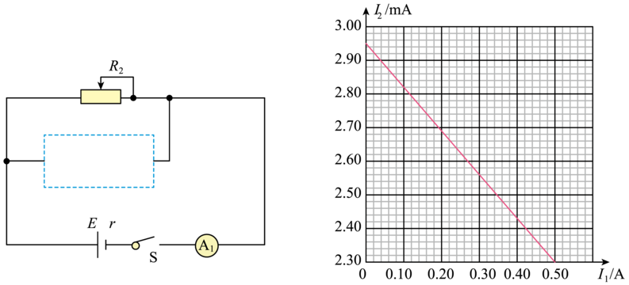

# Physics - 题目 1757

**ID**: 51331c40f45643f187fd3e3e3fc96b2e
**年级**: Grade 11
**难度**: Medium-Hard
**题型**: Experiment

## 题目
新能源汽车的电池放在底盘的上面，几百节可充电电池通过串联和并联连接后，电源电动势可达450V左右。​​​​​​​‌某校学习小组现选取其中一节电池（电动势铭牌上标称电动势为6V，内阻小于2Ω）来测量它的电动势和内阻。（1）由于实验室无法提供量程合适的电压表，物理老师从实验室拿来电流表A_{1}（量程为 ${{0}}{\rm{．}}{{6}}{\rm{A}}$ ，内阻 $r{{}_{1}}=1.2Ω$ ）和A_{2}（量程为3mA，内阻 $r{{}_{2}}=400.0Ω$ ），要求将A_{2}改装成量程为 ${{6}}{\rm{V}}$ 的电压表，则应将A_{2}与电阻箱 $R{{}_{1}}$ （阻值调节范围为 $0\sim 9999.9Ω$ ）（填“串联”或“并联”），并将电阻箱 $R{{}_{1}}$ 的阻值调为Ω（结果保留一位小数）。（2）同学们经过讨论，设计的实验电路如图甲所示，实验室除了提供A_{1}，A_{2}和 $R{{}_{1}}$ 外，也按要求提供了其他器材，同学们正确连接电路。虚线框内（未画出）代表由A_{2}正确改装成的电压表，同学们未对A_{2}的表盘进行重新赋值。（3）同学们正确操作，得到了若干组A_{1}和A_{2}的示数 $I{{}_{1}}$ 、 $I{{}_{2}}$ ，并根据数据绘制出了 $I{{}_{2}}$ 与 $I{{}_{1}}$ 的关系图像如图乙所示，则电池的电动势E=V，内阻r=Ω。（结果均保留三位有效数字）（4）学习小组的同学们经过讨论分析，认为：在忽略偶然误差的情况下，测得的电动势是（填“大于”“小于”或“等于”）真实值。

## 解答

1. 改装电压表需要串联分压电阻，所以应填串联；由 $U=I{{}_{g}}(r{{}_{2}}+R{{}_{1}})$ 有 $R{{}_{1}}=1600.0Ω$ ；由闭合电路欧姆定律 $E=U+Ir$ 有 $E=I{{}_{2}}(r{{}_{2}}+R{{}_{1}})+I{{}_{1}}(r{{}_{1}}+r)=2000I{{}_{2}}+\left ({1.2+r}\right )I{{}_{1}}$ ，所以有 $I{{}_{2}}=-\frac {1.2+r}{2000}I{{}_{1}}+\frac {E}{2000}$ ，由 $I{{}_{2}}-I{{}_{1}}$ 图可知截距 $b=2.95{\rm{m}}{\rm{A}}=\frac {E}{2000}$ , $\left |{k}\right |=\left |{\frac {\left ({2.95-2.3}\right )\times 10{^{-3}}}{0.5-0}}\right |=\frac {1.2+r}{2000}$ ，解得 $E=5.90{\rm{V}}$ ， $r=1.40Ω$ ；这里的电动势与电池内阻关系无任何误差  $E=I{{}_{2}}(r{{}_{2}}+R{{}_{1}})+I{{}_{1}}(r{{}_{1}}+r)=2000I{{}_{2}}+\left ({1.2+r}\right )I{{}_{1}}$ ，如忽略偶然误差如读数误差外，测得的电动势的值就等于真实值。

## 知识点

**中文**:
  - 实验：电池电动势和内阻的测量—安阻法测量电源电动势与内阻

**English**:
  - A-R Method for EMF and Internal Resistance

---
