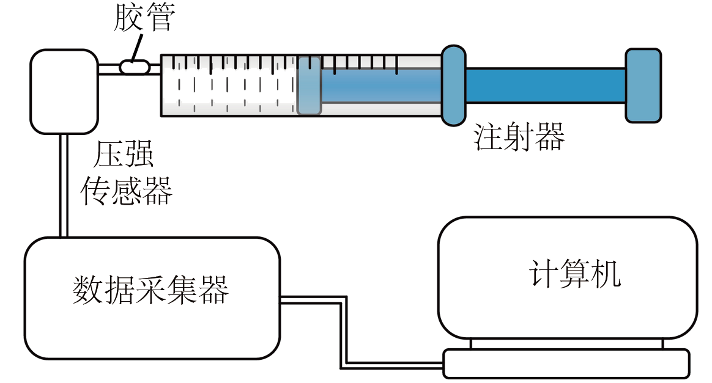

# Physics - 题目 561

**ID**: 5ecb33fc53c84573a2c7f8849d5b7bf9
**年级**: Grade 11
**难度**: Medium-Hard
**题型**: Experiment

## 题目
某班级探究气体等温变化的规律，采用如图1所示的装置进行实验。​​​​​​​‌他们将注射器、压强传感器、数据采集器和计算机逐一连接，在注射器内用活塞封闭一定质量的气体。实验中由注射器的刻度可以读出气体的体积V；计算机屏幕上可以显示由压强传感器测得的压强压强p，从而获得气体不同体积时的压强数值。根据获得的数据，做出相应图像。分析得出结论。（1）关于该实验下列说法正确的是。

## 解答

1. （1）为保证实验中气体气密性，需涂抹润滑油，A错误；本实验的条件是温度不变，所以实验过程中缓慢拉柱塞，不能用手握住注射器，B错误；玻意耳定律成立的前提是等温且质量一定，气体质量具体值不需要测量，C错误；由玻意耳定律可知 $p{{}_{1}}V{{}_{1}}=p{{}_{2}}V{{}_{2}}$ ，只要方程两边压强与体积的单位相同即可，不必采用国际单位，D正确。
2. （2） 若漏气会导致pV之积减小，根据 $pV=CT$ ，可知温度降低， $p-\frac {1}{V}$ 的图像斜率减小。选b。
3. （3）根据 $p\left ({V+V{{}_{0}}}\right )=CT$ ，变形得 $V=CT\frac {1}{p}-V{{}_{0}}$ ，可知 $V-\frac {1}{p}$ 图像仍是一条倾斜的直线，由于未计入注射器与压强传感器之间软管内的气体体积，则此时气体存在初态压强，图像有横截距。

## 知识点

**中文**:
  - 实验：探究气体等温变化的规律

**English**:
  - Experiment: Investigating Isothermal Change (Boyle's Law)

---
