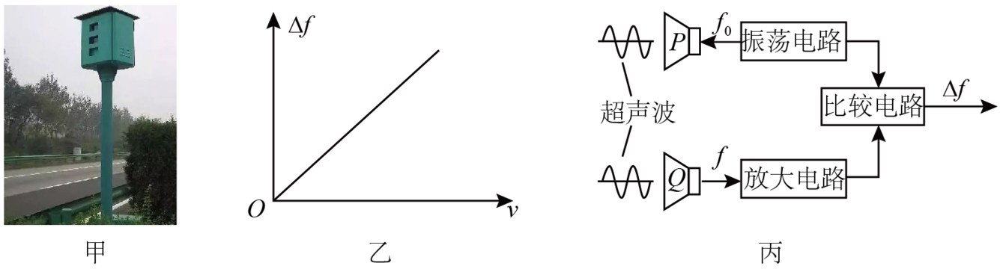

# Physics - 题目 2154

**ID**: 9e27196cd6d44fa4b93dd57acbddca3b
**年级**: Grade 11
**难度**: Medium-Hard
**题型**: Experiment

## 题目
阅读短文，回答下列问题：超声测速仪如图甲所示是公路旁边的超声波测速仪，它向行驶的车辆发射频率为f_{0}（一般为30kHz～100kHz）的超声波，当车辆向它靠近时，车辆反射回来的超声波频率f增大；​​​​​​​‌当车辆远离时，反射回来的超声波频率f减小，变化的频率Δf=|f_{0}-f|与车辆速度v关系如图乙所示．超声波测速仪内部工作原理如图丙所示，P、Q是压电超声换能器，在外力作用下发生形变时会产生电压，形变消失后，电压随之消失；反之，当在其上加一定电压就会发生形变，电压消失后，形变随之消失．超声波测速仪内部振荡电路产生高频交流电压加到P上，P产生相同频率的超声波；被车辆反射回来的超声波在Q上产生交流电压，其频率与反射波的频率相同，比较电路将振荡电路和放大电路的两种频率的交流电压进行比较，计算出它们的差值Δf=|f_{0}-f|，由Δf就能知道车辆的速度．（1）车辆靠近超声波测速仪时，反射回来的超声波频率ff_{0}(填：大于/等于/小于)；（2）超声测速仪工作时，压电超声换能器．

## 解答

1. (1)[1]由短文可知，当车辆向它靠近时，车辆反射回来的超声波频率f增大，所以f大于f_{0}；
2. (2)[2]超声波测速仪内部振荡电路产生高频交流电压加到P上，P产生相同频率的超声波，被车辆反射回来的超声波在Q上产生交流电压，其频率与反射波的频率相同，所以压电超声换能器P将电压转换成形变，Q将形变转换成电压．故应选D．
3. (3)[3]超声波测速仪内部振荡电路产生高频交流电压加到P上，P产生相同频率的超声波；超声波的频率f>20000Hz，所以交流电的频率也大于20000Hz，其周期
4. $T<\frac {1}{f}=\frac {1}{20000}=5\times 10{^{-5}}{\rm{s}}$
5. 故选D；
6. (4)[4]汽车先后以v_{1}和v_{2}的速度远离超声波测速仪时，反射回来超声波的频率分别为f_{1}和f_{2}，且f_{1}大于f_{2}，当车辆远离时，反射回来的超声波频率f减小，则△f_{1}<△f_{2}，由图乙可知，变化的频率△f与车速v成正比，所以v_{1}小于v_{2}．
7. 〖名师点睛〗
8. 超声波的频率是大于20000Hz，据此可求得时间，然后对照图象即可作出选择；根据“当车辆向它靠近时，车辆反射回来的超声波频率f增大；当车辆远离时，反射回来的超声波频率f减小”可知△f_{1}<△f_{2}，由图乙可知，变化的频率△f与车速v成正比，然后可得出结论；根据变化的频率△f与车速v成正比，可知汽车做变速运动，然后可知以测速仪为参照物，该汽车的运动情况．

## 知识点

**中文**:
  - 多普勒效应及其应用

**English**:
  - Doppler Effect and Applications

---
