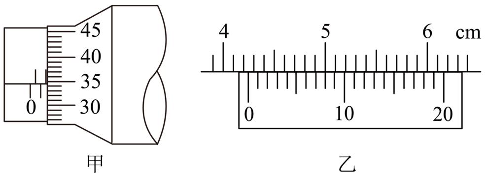

# Physics - 题目 1032

**ID**: c1c8cc2e0c3e41b6b235935357febaa1
**年级**: Grade 11
**难度**: Medium-Hard
**题型**: Experiment

## 题目
某小组用铜棒完成“测定金属电阻率”的实验，电阻约为 $6Ω$ ，实验步骤如下：（1）首先通过螺旋测微器测量铜棒直径，通过游标卡尺测量铜棒的长度，测量结果如图甲、乙所示，则铜棒直径 $D=$mm，铜棒的长度 $L=$cm。​​​​​​​‌（2）为了精确测量该金属的电阻率，除待测铜棒电阻 $R{{}_{x}}$ 外，实验室还备有的实验器材如下：

## 解答

1. （1）螺旋测微器的精确值为 $0.01{\rm{m}}{\rm{m}}$ ，由图可知圆柱体的直径为 $D=1.5{\rm{m}}{\rm{m}}+34.5\times 0.01{\rm{m}}{\rm{m}}=1.845{\rm{m}}{\rm{m}}{\rm ，20}$ 分度游标卡尺的精确值为 $0.05{\rm{m}}{\rm{m}}$ ，由图可知圆柱体的长度为 $L=4.2{\rm{c}}{\rm{m}}+8\times 0.05{\rm{m}}{\rm{m}}=4.240{\rm{c}}{\rm{m}}$ 。
2. （2）由于电源电压为3V，则电压表应选择A；该金属的电阻约为 $6Ω$ ，根据 $I{{}_{{\rm{m}}}}=\frac {U{{}_{{\rm{m}}}}}{R{{}_{x}}}=\frac {3}{6}{\rm{A}}=0.5{\rm{A}}$ ，则电流表应选择D；，要求实验过程电压表的读数能够从零开始调节，则滑动变阻器应采用分压接法，为精细调节，滑动变阻器应选E。
3. （3）因电阻较小，则采用电流表外接；滑动变阻器用分压电路，如图
4. 
5. （4）根据电阻定律可得 $R{{}_{x}}=ρ\frac {L}{S}$ ，又 $R{{}_{x}}=\frac {U}{I},S=\frac {πD{^{2}}}{4}$ ，联立得 $ρ=\frac {πUD{^{2}}}{4IL}$ 。

## 知识点

**中文**:
  - 实验：导体电阻率的测量

**English**:
  - Experiment: Measuring Resistivity

---
