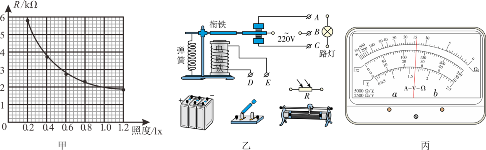

# Physics - 题目 267

**ID**: e074a4e47f00491d83a8775ee2e8a64e
**年级**: Grade 11
**难度**: Medium-Hard
**题型**: Experiment

## 题目
为了节能环保，一些公共场所使用光控开关控制照明系统。​​​​​​​‌光控开关可采用光敏电阻来控制，光敏电阻是阻值随着光的照度而发生变化的元件（照度可以反映光的强弱，光越强，照度越大，照度单位为1x）。（1）某光敏电阻R在不同照度下的阻值如下表，根据表中已知数据，在如图甲所示的坐标系中描绘出了阻值随照度变化的曲线．由图象可求出照度为1.01x时的电阻约为$kΩ$ 。照度/1x0.20.40.60.81.01.2电阻/ $kΩ$5.83.72.82.31.8（2）如图乙所示是街道路灯自由控制模拟电路，利用直流电源为电磁铁供电，利用照明电源为路灯供电。为达到天亮灯熄、天暗灯亮的效果，路灯应接在（填“AB”或“BC”）之间，请用笔画线代替导线，正确连接电路元件。（3）用多用电表“ $\times 10{\rm{Ω}}$ ”挡，按正确步骤测量图乙中电磁铁线圈电阻时，指针示数如图丙所示，则线圈的电阻为$Ω$ 。已知当线圈中的电流大于或等于2mA时，继电器的衔铁将被吸合，图中直流电源的电动势E=6V，内阻忽略不计，滑动变阻器有三种规格可供选择： $R{{}_{1}}\left ({0\sim 10{\rm{Ω}},2{\rm{A}}}\right )、R{{}_{2}}\left ({0\sim 200{\rm{Ω}},1{\rm{A}}}\right )、R{{}_{3}}\left ({0\sim 175{\rm{Ω}},0.1{\rm{A}}}\right )$ 。要求天色渐暗照度降低至1.01x时点亮路灯，滑动变阻器应选择（填“ $R{{}_{1}}$ ”“  $R{{}_{2}}$ ”或“ $R{{}_{3}}$ ”）。为使天色更暗时才点亮路灯，应适当地（填“增大”或“减小”）滑动变阻器的电阻。

## 解答

1. （1）从图像上可以看出当照度为1.01x时的电阻约为 $2.0kΩ$ ；
2. （2）当天亮时，光敏电阻的阻值变小，所以回路中电流增大，则衔铁被吸下来，此次触片和下方接触，此时灯泡应该熄灭，说明灯泡接在了AB上，连接电路图如图所示
3. 
4. （3）根据欧姆表的读数规则，所以电阻值为 $R=14.0\times 1{\rm{Ω}}=14.0{\rm{Ω}}$ ，回路中的电流为2mA时回路中的需要中电阻 $R{{}_{x}}=\frac {E}{I}=\frac {6}{0.002}{\rm{Ω}}=3000{\rm{Ω}}$ ，所以选择滑动变阻器 $R{{}_{3}}$ 比较合理。若要求天色渐暗照度降低至1.01x时点亮路灯，则天色更暗时光明电阻更大，要先保证回路中的电流2mA不变，则应减小滑动变阻器的阻值。

## 知识点

**中文**:
  - 生活中的传感器

**English**:
  - Sensors in Daily Life

---
