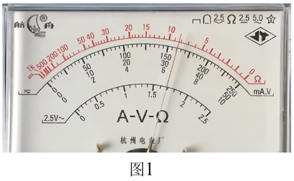
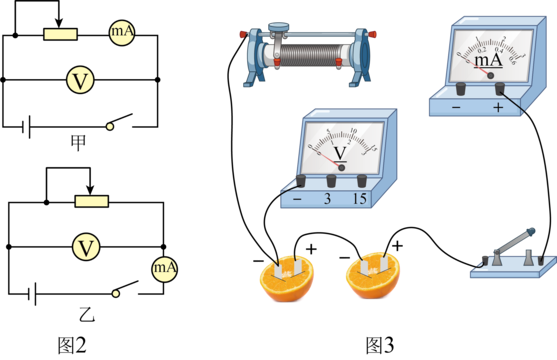

# Physics - 题目 1122

**ID**: ef776c04e00d497e98ea074904652804
**年级**: Grade 11
**难度**: Medium-Hard
**题型**: Experiment

## 题目
某学习小组通过查阅资料了解到，将铜、锌电极插入水果中所构成的水果电池，电动势在1V左右，内电阻在几百至上千欧，于是他们用橙子和金属电极做了两个水果电池并串联成电池组，测量其总电动势和总内阻。​​​​​​​‌（1）首先用多用电表直流2.5V挡粗测水果电池的电动势，如图1所示，读数为V；（2）然后用伏安法精确测量水果电池的电动势和内阻，器材有：电压表 $\left ({0-3\,{\rm{V}}-15\,{\rm{V}},5{\rm{k}}{\rm{Ω}}}\right )$ ，电流表 $\left ({0-1{\rm{m}}{\rm{A}},5{\rm{Ω}}}\right )$ ，滑动变阻器 $\left ({5.5{\rm{k}}{\rm{Ω}},0.1{\rm{A}}}\right )$ ，开关及导线若干。在图2所示电路图中，比较合理的是（填“甲”或“乙”），请按此将图3电路连接完成。（3）连接好电路后，闭合开关，调节滑动变阻器的滑片，记录电压表和电流表的读数，作 $U-I$ 图像如图4所示，则水果电池总电动势 $E=$${\rm{V}}$ ，总内阻 $R=$${\rm{k}}Ω$ （此空保留2位有效数字）。

## 解答

1. （1）多用电表直流2.5V挡最小刻度为0.05V，则读数为1.60V；
2. （2）在图2所示电路图中，因电流表内阻远小于水果电池的内阻，可知比较合理的是乙，按此将图3电路连接完成如图；
3. 
4. （3）根据U=E-IR，由图像可知水果电池总电动势 $E={\rm 1.94V}$ ，总内阻 $R=\frac {1.94-0.80}{0.76\times 10{^{-3}}}Ω=1.5{\rm{k}}{\rm{Ω}}$

## 知识点

**中文**:
  - 实验：电池电动势和内阻的测量—伏安法测量电源电动势与内阻

**English**:
  - V-A Method for EMF and Internal Resistance

---
