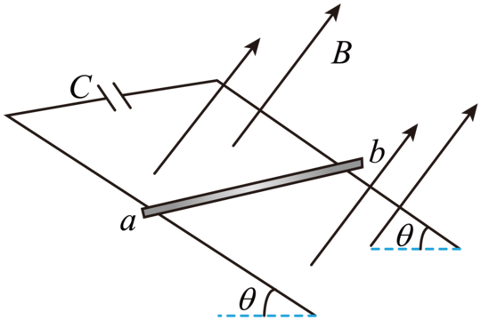

# Physics - 题目 1725

**ID**: 01e6256b61fe4b39a27c91e39193bd23
**年级**: Grade 11
**难度**: Medium-Hard
**题型**: Multiple-choice

## 题目
如图所示，两电阻不计的足够长导轨倾斜放置，导轨由上部的光滑部分和下部的粗糙部分组成，其中粗糙部分的动摩擦因数 $μ={\tan}θ$ ，空间有垂直导轨平面向上的匀强磁场，导轨上端接有电容器，一导体棒ab在 $t=0$ 时刻从光滑区域由静止释放。​​​​​​​‌ $t{{}_{0}}$ 时刻导体棒开始进入导轨的粗糙部分，导体棒运动过程中与导轨接触良好，则电容器所带电荷量q，ab棒中安培力的冲量I，ab棒的速度v，ab棒克服安培力做功W与时间t的关系图像正确的是（      ）

## 解答

1. 在光滑区域，导体棒切割磁感线，产生电动势 $E=Blv$ ，所以产生的电荷量 $q=CE=CBlv$ ，则电流的大小为 $I=\frac {q}{t}=\frac {CBlv}{t}$ ，所以该区域安培力的大小可表示为 $F{{}_{安}}=BIL=\frac {CB{^{2}}l{^{2}}v}{t}$ ，则安培力的冲量 $I=F{{}_{安}}t{\rm{=}}CB{^{2}}l{^{2}}v$ ，则克服安培力做功 $W=CB{^{2}}l{^{2}}v{^{2}}$ ，根据牛顿第二定律有 $mg\sin θ-F{{}_{安}}{\rm{=}}ma$ ，解得 $a=\frac {mg\sin θ}{m+CB{^{2}}l{^{2}}}$ ，它是一个常数说明在 $0\sim t{{}_{0}}$ 这段时间内，ab棒的速度v与时间t成正比，电容器所带电荷量q与时间t成正比，ab棒中安培力的冲量I与时间t成正比，ab棒克服安培力做功W与时间 $t{^{2}}$ 成正比，在粗糙区域，根据牛顿第二定律有 $-F{{}_{安}}=ma$  ，解得 $a=0$ ，说明粗糙区域内做匀速直线运动，说明在 $t{{}_{0}}$ 之后，ab棒的速度v恒定，电容器所带电荷量q恒定，ab棒中安培力的冲量I与时间t成正比，ab棒克服安培力做功W恒定

## 知识点

**中文**:
  - 电磁感应定律中的图像问题

**English**:
  - Graph Problems in EM Induction

---
