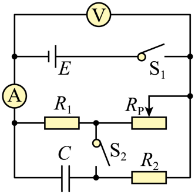

# Physics - 题目 644

**ID**: 03762be97ad54649b96b3cd79489e9d4
**年级**: Grade 11
**难度**: Medium-Hard
**题型**: Multiple-choice

## 题目
如图所示，直流电路中电源电动势为 $E$ ，内阻为r、 $R{{}_{1}}$ 、 $R{{}_{2}}$ 为定值电阻， $R{{}_{{\rm{P}}}}$ 为滑动变阻器，已知 $R{{}_{1}}=R{{}_{2}}$ ，电容器电容 $C$ ，现闭合 ${\rm{S}}{{}_{1}}$ ，断开 ${\rm{S}}{{}_{2}}$ ，下列说法正确的是（      ）​​​​​​​‌

## 解答

1. A．闭合 ${\rm{S}}{{}_{1}}$ ，断开 ${\rm{S}}{{}_{2}}$ ，滑片逐渐向左滑动，滑动变阻器接入电阻减小，电路总电阻减小，干路电流增大，即电流表示数 $I$ 增大，根据闭合电路欧姆定律有 $U=E-Ir$ ，可知电压表示数U减小，A错误；
2. B．根据上述，闭合 ${\rm{S}}{{}_{1}}$ ，断开 ${\rm{S}}{{}_{2}}$ ，电容器所在支路等压等于路端电压，即等于电压表示数U，可知电容器两端电势差 $U{{}_{C}}$ 减小，B错误；
3. C．根据上述有 $U=E-Ir$ ，则由 $\frac {ΔU}{ΔI}=-r$ 可知， $\frac {ΔU}{ΔI}$ 保持不变，C正确；
4. D．滑动变阻器滑片置于中点，闭合 ${\rm{S}}{{}_{2}}$ ，此时，定值电阻 $R{{}_{2}}$ 与滑动变阻器并联后与定值电阻 $R{{}_{1}}$ 串联，电容器两端电压等于定值电阻 $R{{}_{1}}$ 两端电压，在滑动变阻器滑片置于中点，闭合 ${\rm{S}}{{}_{2}}$ 之前，电容器两端电压为 $U{{}_{1}}=\frac {E\left ({R{{}_{1}}+R{{}_{中}}}\right )}{R{{}_{1}}+r+R{{}_{中}}}=\frac {E}{1+\frac {r}{R{{}_{中}}+R{{}_{2}}}}$ ，在滑动变阻器滑片置于中点，闭合 ${\rm{S}}{{}_{2}}$ 之后，由于 $R{{}_{1}}=R{{}_{2}}$ ，则电容器两端电压为 $U{{}_{2}}=\frac {ER{{}_{1}}}{R{{}_{1}}+r+\frac {R{{}_{中}}R{{}_{2}}}{R{{}_{中}}+R{{}_{2}}}}=\frac {E}{1+\frac {r}{R{{}_{1}}}+\frac {R{{}_{中}}}{R{{}_{中}}+R{{}_{1}}}}$ ，可知 $U{{}_{1}}>U{{}_{2}}$ ，根据电容器电容的定义式有 $C=\frac {Q}{U}$ ，由于电压减小，可知电荷量减小，电容器处于放电状态，D错误，选C。

## 知识点

**中文**:
  - 电路的动态分析问题

**English**:
  - Dynamic Circuit Analysis

---
