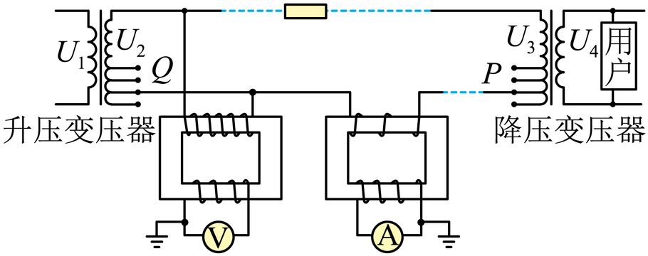

# Physics - 题目 1901

**ID**: 04e663cc27324f66a94e580b23c94e3c
**年级**: Grade 11
**难度**: Medium-Hard
**题型**: Multiple-choice

## 题目
“西电东送”是我国实现经济跨区域可持续快速发展的重要保证，如图所示为模拟远距离高压输电的示意图。​​​​​​​‌已知升压变压器原、副线圈两端的电压分别为U_{1}和U_{2}，降压变压器原、副线圈两端的电压分别为U_{3}和U_{4}．在输电线路的起始端接入两个互感器，两个互感器原、副线圈的匝数比分别为20:1和1:20，各互感器和电表均为理想状态，则下列说法中正确的是（      ）

## 解答

1. 仅将滑片Q下移，升压变压器副线圈的匝数n_{2}增大；根据理想变压器的规律 $U{{}_{2}}=\frac {n{{}_{2}}}{n{{}_{1}}}U{{}_{1}}$ ，升压变压器副线圈两端的电压增大，降压变压器原线圈两端电压U_{3}增大，副线圈两端电压U_{4}增大；又因为用户数不变，降压变压器副线圈电流I_{4}增大；降压变压器原线圈中的电流 $I{{}_{3}}=\frac {n{{}_{4}}}{n{{}_{3}}}I{{}_{4}}$ ，匝数比不变，I_{3}增大；根据 ${\rm{Δ}}P=I{{}_{3}}r$ ，则输电线上损耗功率增大，A正确；电压互感器起降压作用，电流互感器起减小电流作用，B错误；电压互感器原线圈两端电压 $U{{}_{2}}=\frac {n^{′}{{{}_{1}}}}{n^{′}{{{}_{2}}}}U=\frac {20}{1}\times 200{\rm{V}}=4000{\rm{V}}$ ，电流互感器原线圈中的电流 $I{{}_{2}}=\frac {n^{′}{{{}_{4}}}}{n^{′}{{{}_{3}}}}I=\frac {20}{1}\times 5{\rm{A}}=100{\rm{A}}$ ，线路输送电功率 $P=P{{}_{2}}=U{{}_{2}}I{{}_{2}}=4000\times 100{\rm{W}}=400{\rm{k}}{\rm{W}}{\rm ，C}$ 错误；仅增加用户数，负载增大，降压变压器副线圈的电流增大，降压变压器原线圈中的电流增大；输电线上的电压损失 ${\rm{Δ}}U=I{{}_{3}}r$ ，输电线上的电压损失增大；降压变压器线圈两端电压 $U{{}_{3}}=U{{}_{2}}-{\rm{Δ}}U$ 减小；根据 $U{{}_{4}}=\frac {n{{}_{4}}}{n{{}_{3}}}U{{}_{3}}{\rm ，\mathit{U}_{4}}$ 减小；当U_{3}减小时，降压变压器的滑片P上移，减小n_{3}可以使U_{4}不变；所以发电机输出电压U_{1}一定，增加用户数，为维持用户电压U_{4}不变，可将滑片P上移。D错误。

## 知识点

**中文**:
  - 理想变压器原、副线圈两端的电压、功率、电流关系及其应用
  - 电能的输送

**English**:
  - Voltage, Power, Current Relations in Ideal Transformers
  - Transmission of Electrical Energy

---
