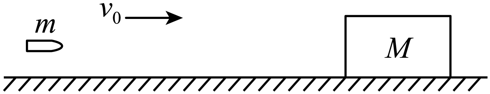

# Physics - 题目 1557

**ID**: 16666e4bcc894553a5d91118792d9fc6
**年级**: Grade 11
**难度**: Medium-Hard
**题型**: Multiple-choice

## 题目
如图所示，光滑水平面上有一质量为M的物块静止放置，物块左侧有一发射装置可以连续向右射出质量均为m的子弹，每颗子弹的初速度大小均为 $v{{}_{0}}$ ，每颗子弹与物块作用时间极短，子弹在物块中所受作用力大小不变，且全部子弹均停留在物块中，子弹可视为质点，已知 $M>m$ ，下列说法正确的是（      ）​​​​​​​‌

## 解答

1. 物块稳定时的速度大小为 $v{{}_{5}}$ ，根据动量守恒定律有 $5mv{{}_{0}}=\left ({5m+M}\right )v{{}_{5}}$ ，解得 $v{{}_{5}}=\frac {5mv{{}_{0}}}{\left ({5m+M}\right )}{\rm ，A}$ 错误；设打入第4颗子弹后木块速度为 $v{{}_{4}}$ ，根据动量守恒定律有 $4mv{{}_{0}}=\left ({4m+M}\right )v{{}_{4}}$ ，解得 $v{{}_{4}}=\frac {4mv{{}_{0}}}{\left ({4m+M}\right )}$ ，根据动量定理可知第5颗子弹对物块的冲量大小为 $I=Mv{{}_{5}}-Mv{{}_{4}}$ ，联立解得 $I=\frac {5Mmv{{}_{0}}}{\left ({5m+M}\right )}-\frac {4Mmv{{}_{0}}}{\left ({4m+M}\right )}{\rm ，B}$ 正确；由AB选项可知，随着子弹的打入，物块速度越来越大，子弹与物块的相对速度越来越小，可知子弹打入物块后与物块的相对路程越来越小，根据 $Q=fs$ ，可知产生的热量越来越少，根据功能关系可知损失的机械能越来越小，CD错误。

## 知识点

**中文**:
  - 子弹-木块模型

**English**:
  - Bullet-Block Model

---
