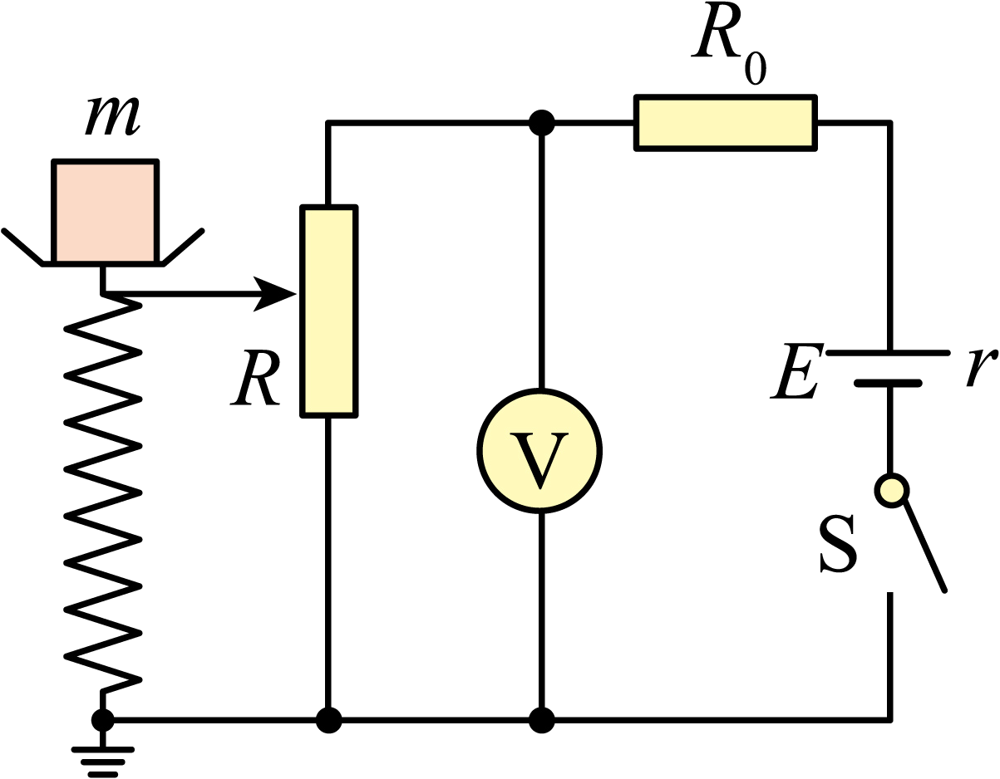

# Physics - 题目 284

**ID**: 2157b9485b744400a77cf53151542e08
**年级**: Grade 11
**难度**: Medium-Hard
**题型**: Multiple-choice

## 题目
某同学在研究性学习活动中自制电子秤，原理示意图如图所示。​​​​​​​‌用理想电压表的示数指示物体的质量，托盘与电阻可忽略的金属弹簧相连，托盘与弹簧的质量均不计，滑动变阻器R的滑动端与弹簧上端连接。当托盘中没有放物体时，滑片恰好指在变阻器的最上端，此时电压表指针指向最左端，示数为0。设变阻器总电阻为R，总长度为l，电源电动势为E，内阻为r，限流电阻阻值为 $R{{}_{0}}$ ，弹簧劲度系数为k，不计一切摩擦和其他阻力。下列说法中正确的是（      ）

## 解答

1. 弹簧电阻不计，电压表测量滑动变阻器上半部分电阻电压，所称物体质量越大，滑动变阻器上半部分电阻越大，电路总电阻越大，电流越小， $R{{}_{0}}$ 和电源内阻上分到的电压越小，故滑动变阻器上电压越大，即电压表示数越大，故A错误；称量物体的质量越大，接入电路的滑动变阻器阻值越大，由闭合电路欧姆定律，有 $I=\frac {E}{R{{}_{x}}+R{{}_{0}}+r}$ ，电路消耗的总功率 $P=EI$ ，可知 $R{{}_{x}}$ 越大，I越小，P越小，故B错误；当托盘中没有放物体时，电压表示数为零，当物体质量为m时，设物体下降x，平衡条件有mg=kx， 根据欧姆定律得 $I=\frac {E}{R{{}_{x}}+R{{}_{0}}+r}$ ， 故电压表读数为 $U=IR{{}_{x}}=\frac {ER{{}_{x}}}{r+R{{}_{0}}+R{{}_{x}}}$ ，根据电阻定律，有 $R{{}_{x}}=\frac {x}{l}R$ ，联立解得 $U=\frac {mgRE}{mgR+kl\left ({R{{}_{0}}+r}\right )}$ ，变式可得 $U=\frac {E}{1+\frac {kl\left ({R{{}_{0}}+r}\right )}{gR}\cdot \frac {1}{m}}$  ，令 $\frac {kl\left ({R{{}_{0}}+r}\right )}{gR}=b$ ，可得 $U=\frac {E}{1+\frac {b}{m}}=\frac {mE}{m+b}$ ，可知该式为 $U-m$ 曲线，对该函数式进行求导，得 $U^{′}=\frac {Eb}{{\left({m+b}\right)^{2}}}$ ，可知随着m的增大， $U^{′}$ 在减小，即 $\frac {ΔU}{Δm}$ 在减小，故当m越大时，对于相同的 $Δm$ 值 $\Delta U$ 越小，所以若将电压表表盘改写为等质量间隔的电子秤表盘后，当m越大时指针越靠右，此时等质量间隔时的 $\Delta U$ 越小，即刻度线越密，故C正确；因为滑动变阻器可滑动的最大长度不变，当更换不同劲度系数的弹簧后，根据 $mg=kx$ ，可知对应的最大可称重的质量改变，由于滑动变阻器的最大阻值不变，指示出的电压表的最大示数不变，所以更换不同劲度系数的弹簧后，只需将该劲度系数下的最大可称重质量标记在电压表最大示数处即可，此时最大示数处所指示的质量就是电子秤的量程，所以电子秤的量程会改变，且劲度系数越大，对应的量程越大，劲度系数越小，对应的量程越小，故D错误。

## 知识点

**中文**:
  - 电阻应变片
  - 闭合电路的欧姆定律及其应用

**English**:
  - Strain Gauge
  - Ohm's Law for Closed Circuits and Applications

---
