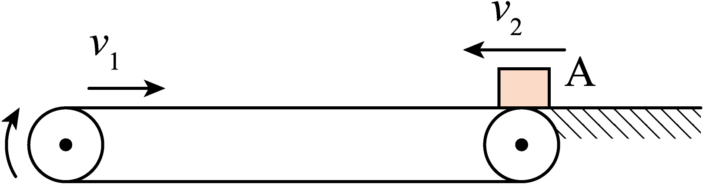

# Physics - 题目 491

**ID**: 359b7a0054ae4c11aae020e8a3979cf5
**年级**: Grade 11
**难度**: Medium-Hard
**题型**: Multiple-choice

## 题目
如图所示，绷紧的水平传送带顺时针匀速运行，初速度大小为v_{2}的小物块从与传送带右端等高的光滑平台上的A处滑上传送带。​​​​​​​‌现保证v_{2}不变，使传送带每次以不同速率v_{1}匀速运行，传送带足够长。用t表示物块在传送带上运动的时间，用Δs表示物块运动过程中与传送带之间产生的划痕的长度。下列图像可能正确的是（      ）

## 解答

1. 若v_{1}≥v_{2}，作出此时对应的v−t图像如图所示
2. 
3. 可知滑块从滑上传送带到滑离传送带用时 $t{{}_{1}}=\frac {2v{{}_{2}}}{μg}$ ，可知t_{1}恒定与v_{1}无关。划痕长度为 ${\rm{Δ}}s{{}_{1}}=v{{}_{1}}\frac {t{{}_{1}}}{2}+\frac {v{{}_{2}}}{2}\cdot \frac {t{{}_{1}}}{2}+\left ({v{{}_{1}}\frac {t{{}_{1}}}{2}-\frac {v{{}_{2}}}{2}\cdot \frac {t{{}_{1}}}{2}}\right )=v{{}_{1}}t{{}_{1}}=\frac {2v{{}_{1}}v{{}_{2}}}{μg}$ ，可知Δs与v_{1}成正比，且图像延长线应过原点，AC错误；若0<v_{1}<v_{2}，作出此时对应的v−t图像如图所示
4. 
5. 由图可知滑块从滑上传送到到滑离传送带用时 $t{{}_{2}}=\frac {v{{}_{2}}}{μg}+\frac {v{{}_{1}}}{μg}+\frac {\left ({\frac {v{{}_{2}^{2}}}{2μg}-\frac {v{{}_{1}^{2}}}{2μg}}\right )}{v{{}_{1}}}=\frac {v{{}_{2}}}{μg}+\frac {v{{}_{1}}}{2μg}+\frac {v{{}_{2}^{2}}}{2μgv{{}_{1}}}$ ，划痕长度为 ${\rm{Δ}}s{{}_{1}}=\frac {v{{}_{2}^{2}}}{2μg}+v{{}_{1}}\cdot \frac {v{{}_{2}}}{μg}+\left ({v{{}_{1}}\cdot \frac {v{{}_{1}}}{μg}-\frac {v{{}_{1}^{2}}}{2μg}}\right )=\frac {(v{{}_{1}}+v{{}_{2}}){^{2}}}{2μg}{\rm ，Δ\mathit{s}}$ 是关于v_{1}的二次函数，且不过原点，划痕Δs关于v_{1}的正确图像如图所示
6. 
7. B正确，D错误。

## 知识点

**中文**:
  - v-t图像及其应用
  - 传送带模型

**English**:
  - v-t Graphs and Applications
  - Conveyor Belt Model

---
