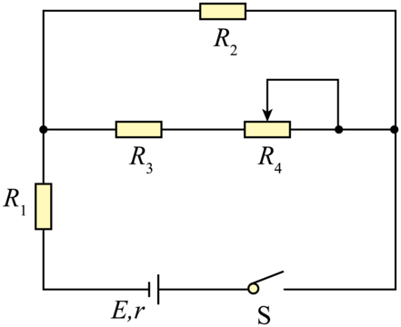

# Physics - 题目 1843

**ID**: 38bf6f419c7545ac9b21266de1095273
**年级**: Grade 11
**难度**: Medium-Hard
**题型**: Multiple-choice

## 题目
如图所示电路中，电源电动势 $E=8{\rm{V}}$ ，内阻 $r=1Ω$ ，定值电阻 $R{{}_{1}}=9\Omega $ ， $R{{}_{2}}=10\Omega $ ， $R{{}_{3}}=5\Omega $ ；滑动变阻器 $R{{}_{4}}$ 的取值范围为 $0\sim 15Ω$ 。​​​​​​​‌闭合开关S，调节滑动变阻器的滑片，使 $R{{}_{4}}$ 取不同的阻值接入电路，则下列说法正确的是（      ）

## 解答

1. $R{{}_{4}}=0$ 时，外电阻最小，总电流最大，则定值电阻 $R{{}_{1}}$ 消耗的功率最大，此时并联部分的总阻值为 $R{{}_{23}}=\frac {R{{}_{2}}\cdot R{{}_{3}}}{R{{}_{2}}+R{{}_{3}}}=\frac {10}{3}Ω$ ，由闭合电路欧姆定律得干路电流为 $I=\frac {E}{R{{}_{23}}+R{{}_{1}}+r}=0.6{\rm{A}}$ ，则定值电阻 $R{{}_{1}}$ 消耗的功率为 $P{{}_{1}}=I{^{2}}R{{}_{1}}=3.24{\rm{W}}$ ，故A错误；当电源内阻消耗的功率最小时，由 $P{{}_{{\rm{内}}}}=I{^{2}}r$ ，知此时电路中的总电流最小，对应的外电阻最大，故当 $R{{}_{4}}=5Ω$ 时，总的外电阻并未达最大值，故B错误；为求滑动变阻器 $R{{}_{4}}$ 消耗的最大功率，可对原电路进行如下图所示的等效变换。
2. 
3. 易知，等效电源的等效电动势 $E^{′}=4{\rm{V}}$ ，等效内阻 $r^{′}=10Ω$ ，故当 $R{{}_{4}}=r^{′}=10Ω$ 时， $R{{}_{4}}$ 消耗的功率最大，且为 $P{{}_{{\rm \max }}}=\frac {E^{′}{{^{2}}}}{4r^{′}}=0.4{\rm{W}}$ ，故C正确；当 $R{{}_{4}}=15Ω$ 时，总的外电阻最大。由于电源效率为 $η=\frac {U}{E}\times 100\%=\frac {R}{R+r}\times 100\%==\frac {1}{1+\frac {r}{R}}\times 100\%$ ，显然，当总的外电阻R最大时， $η$ 取最大值，当 $R{{}_{4}}=15Ω$ 时，总的外电阻为 $R^{′}=\frac {R{{}_{2}}\cdot \left ({R{{}_{3}}+R{{}_{4}}}\right )}{R{{}_{2}}+\left ({R{{}_{3}}+R{{}_{4}}}\right )}+R{{}_{1}}=\frac {47}{3}Ω$ ，此时 $η$ 最大，且为 $η=\frac {R^{′}}{R^{′}+r}\times 100\%=94\%$ ，故D错误。

## 知识点

**中文**:
  - 电路的动态分析问题
  - 闭合电路输出功率与效率

**English**:
  - Dynamic Circuit Analysis
  - Output Power and Efficiency of Closed Circuits

---
