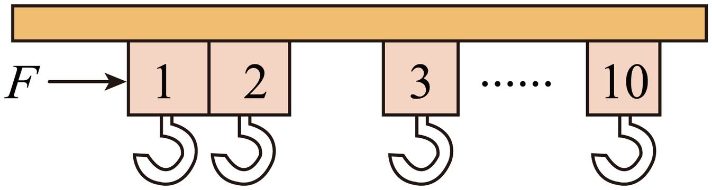

# Physics - 题目 1960

**ID**: 582768fb59de4e5d9c9ac18248e2a501
**年级**: Grade 11
**难度**: Medium-Hard
**题型**: Multiple-choice

## 题目
某同学受电动窗帘的启发，设计了如图所示的简化模型。​​​​​​​‌多个质量均为1kg的滑块可在水平滑轨上滑动，忽略阻力，开窗帘过程中，电机对滑块1施加一个水平向右的恒力F，推动滑块1以0.4m/s的速度与静止的滑块2碰撞，碰撞时间为0.04s，碰撞结束后瞬间两滑块的共同速度为0.22m/s。关于两滑块的碰撞过程，下列说法正确的有（      ）

## 解答

1. 选择水平向右的方向为正方向。滑块1和滑块2组成的系统的初动量为p_{1}=mv_{1}=1×0.40kg∙m/s=0.40kg∙m/s，碰撞后，滑块1和滑块2组成的系统的动量为p_{2}=2mv_{2}=2×1×0.22kg∙m/s=0.44kg∙m/s，则滑块的碰撞过程动量不守恒，A错误；对滑块1，根据动量定理可得ΔI=mv_{2}−mv_{1}，代入数据解得ΔI=−0.18N∙s，负号表示方向水平向左，B正确；同理可得，对滑块2分析可得ΔI′=mv_{2}−0，代入数据解得ΔI′=0.22N∙s，C错误；根据公式ΔI′=FΔt，代入数据解得F=5.5N，D错误。

## 知识点

**中文**:
  - 动量
  - 动量定理及其应用

**English**:
  - Momentum
  - Applications of Impulse-Momentum Theorem

---
