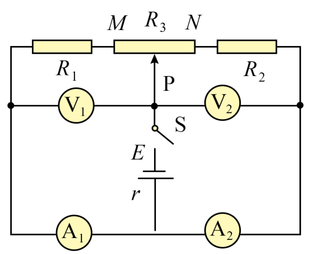

# Physics - 题目 359

**ID**: 5a4878db51894ab480a2d879b18e677c
**年级**: Grade 11
**难度**: Medium-Hard
**题型**: Multiple-choice

## 题目
如图所示，电阻 $R{{}_{1}}=2.0Ω$ ， $R{{}_{2}}=3.0Ω$ ， $R$ 为一滑动变阻器，电压表、电流表均为理想电表，且电源内阻恒定。​​​​​​​‌现将开关S闭合，调节滑片P，观察电压表和电流表示数的变化。当滑片P距 $R{{}_{3}}$ 左端 $M$ 点的长度为 $R{{}_{3}}$ 总长度的 $\frac {3}{5}$ 时，两个电压表的示数均达到最大值。下面正确的是（      ）

## 解答

1. A：由图可知，两个电压表测量的都是路端电压，所以比值始终不变，A错误；
2. B：两支路电压始终相同，所以电流与电阻成反比，滑片P从 $M$ 端滑向 $N$ 端过程左边支路电阻增大，右边支路电阻减小，所以在 $\frac {I{{}_{1}}}{I{{}_{2}}}$ 减小，B错误；
3. C：设 $MP$ 间阻值为 $R{{}_{x}}$ ，则并联部分的总阻值为 $R=\frac {\left ({R{{}_{1}}+R{{}_{x}}}\right )\left ({R{{}_{2}}+R{{}_{3}}-R{{}_{x}}}\right )}{R{{}_{1}}+R{{}_{2}}+R{{}_{3}}}=\frac {-R{{}_{x}^{2}}+\left ({1+R{{}_{3}}}\right )R{{}_{x}}+2R{{}_{3}}+6}{5+R{{}_{3}}}$ ，其分子是 $R{{}_{x}}$ 的二次函数，由已知条件知， $R{{}_{x}}=\frac {3R{{}_{3}}}{5}$ 时，两个电压表的示数均达到最大值，此时 $R$ 应具有极大值，利用二次函数求极值的公式得到 $R{{}_{x}}=-\frac {1+R{{}_{3}}}{2\times (-1)}=\frac {3R{{}_{3}}}{5}$ ，解得 $R{{}_{3}}=5.0Ω{\rm ，C}$ 错误；
4. D：依题意，当滑片P距 $R{{}_{3}}$ 左端 $M$ 点的长度为 $R{{}_{3}}$ 总长度的 $\frac {3}{5}$ 时，外电路电阻为 ${\rm{R}}{{}_{外}}=\frac {\left ({R{{}_{1}}+\frac {3}{5}R{{}_{3}}}\right )\left ({R{{}_{2}}+\frac {2}{5}R{{}_{3}}}\right )}{R{{}_{1}}+\frac {3}{5}R{{}_{3}}+R{{}_{1}}+\frac {3}{5}R{{}_{3}}}=2.5{\rm{Ω}}$ ，当外电路总电阻与电源内阻相等时，电源输出功率有最大值，所以若电源内阻 $r=2.5Ω$ ，电压表示数达到最大值时，电源的输出功率也达到最大值，D正确。选D。

## 知识点

**中文**:
  - 闭合电路输出功率与效率

**English**:
  - Output Power and Efficiency of Closed Circuits

---
