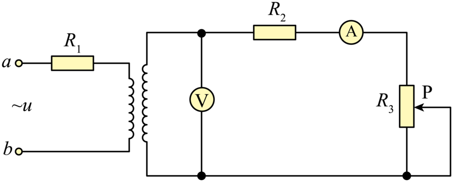

# Physics - 题目 2223

**ID**: 7f34262532164395a11549e04b8fb07e
**年级**: Grade 11
**难度**: Medium-Hard
**题型**: Multiple-choice

## 题目
如图所示为模拟远距离输电的部分测试电路。​​​​​​​‌ $a$ 、 $b$ 端接电压有效值恒定的正弦交流电源，理想变压器的原、副线圈匝数比为 $k{\rm ，}$  $R{{}_{1}}$ 和 $R{{}_{2}}$ 为定值电阻，电流表、电压表均为理想电表，其示数分别用 $I$ 和 $U$ 表示。当滑动变阻器 $R{{}_{3}}$ 的滑片P从最下端向最上端滑动过程中，电流表、电压表示数变化量分别用 $ΔI$ 和 $\Delta U$ 表示。下列说法一定正确的是（      ）

## 解答

1. A．根据变压器的原理可得 $\frac {U{{}_{1}}}{U{{}_{2}}}=k{\rm ，}$  $\frac {I{{}_{2}}}{I{{}_{1}}}=k{\rm ，}$ 可得 $U{{}_{1}}=kU{{}_{2}}{\rm ，}$  $I{{}_{1}}=\frac {I{{}_{2}}}{k}{\rm ，}$ 原线圈电路中有 $U{{}_{0}}=U{{}_{1}}+I{{}_{1}}R{{}_{1}}{\rm ，}$ 在副线圈电路中有 $U{{}_{2}}=I{{}_{2}}\left ({R{{}_{2}}+R{{}_{3}}}\right ){\rm ，}$ 联立可得 $U{{}_{0}}=U{{}_{2}}\left [k+\frac {R{{}_{1}}}{k\left ({R{{}_{2}}+R{{}_{3}}}\right )}\right ]{\rm ，}$ 当滑片P从最下端向最上端滑动过程中，电阻 $R{{}_{3}}$ 阻值减小，电源电压 $U{{}_{0}}$ 不变，可知 $U{{}_{2}}$ 减小，即电压表的示数U减小，A错误；
2. B．由A项分析可得
3. $U{{}_{0}}=kU{{}_{2}}+\frac {I{{}_{2}}}{k}R{{}_{1}}$
4. 变形得
5. $U{{}_{2}}=\frac {U{{}_{0}}}{k}-\frac {R{{}_{1}}}{k{^{2}}}I{{}_{2}}$
6. 则有
7. $\left |{\frac {\Delta U}{\Delta I}}\right |=\frac {R{{}_{1}}}{k{^{2}}}$
8. 即
9. $R{{}_{1}}=k{^{2}}|\frac {\Delta U}{\Delta I}|$
10. B正确；
11. C．由能量守恒定律可得
12. $I{{}_{1}}U{{}_{0}}=I{{}_{1}^{2}}R{{}_{1}}+I{{}_{2}^{2}}\left ({R{{}_{2}}+R{{}_{3}}}\right )$
13. 可得
14. $I{{}_{1}}=\frac {U{{}_{0}}}{R{{}_{1}}+k{^{2}}\left ({R{{}_{2}}+R{{}_{3}}}\right )}$
15. 副线圈回路消耗的功率
16. $P=I{{}_{2}^{2}}\left ({R{{}_{2}}+R{{}_{3}}}\right )=k{^{2}}I{{}_{1}^{2}}\left ({R{{}_{2}}+R{{}_{3}}}\right )$
17. 把 $I{{}_{1}}$ 代入得
18. $P=\frac {U{{}_{0}^{2}}\cdot k{^{2}}\left ({R{{}_{2}}+R{{}_{3}}}\right )}{\left [R{{}_{1}}+k{^{2}}\left ({R{{}_{2}}+R{{}_{3}}}\right )\right ]{^{2}}}=\frac {U{{}_{0}^{2}}}{\frac {\left [k{^{2}}\left ({R{{}_{2}}+R{{}_{3}}}\right )-R{{}_{1}}\right ]}{k{^{2}}\left ({R{{}_{2}}+R{{}_{3}}}\right )}+4R{{}_{1}}}$
19. 可知当 $k{^{2}}\left ({R{{}_{2}}+R{{}_{3}}}\right )=R{{}_{1}}$ 时，副线圈输出功率最大；当滑片P从最下端向最上端滑动过程中，电阻 $R{{}_{3}}$ 阻值由最大减小到0，当 $k{^{2}}\left ({R{{}_{2}}+R{{}_{3}}}\right )$ 由大于 $R{{}_{1}}$ 减小到小于 $R{{}_{1}}{\rm ，}$ 副线圈输出功率并不是一直增大，C错误；
20. D．当向上调节滑动变阻器的滑片P时，副线圈的总电阻减小，所以回路中的电流增大，电源的电压不变，所以电源的输出功率一定增大，D错误。
21. 选B。

## 知识点

**中文**:
  - 含有理想变压器的动态电路分析
  - 理想变压器原、副线圈两端的电压、功率、电流关系及其应用

**English**:
  - Dynamic Circuit Analysis with Ideal Transformers
  - Voltage, Power, Current Relations in Ideal Transformers

---
