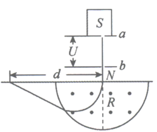

# Physics - 题目 26

**ID**: 88091dc61b304cd39701fff3df2d0260
**年级**: Grade 11
**难度**: Medium-Hard
**题型**: Multiple-choice

## 题目
质谱仪的出现对人们研究同位素提供了帮助，如图所示，粒子发射源 $S$ 发出的粒子经加速电压 $U$ 加速后，由狭缝 $N$ 射入下侧半径为 $R$ 的半圆形磁场区域，磁场方向垂直纸面向外，半圆的圆心与狭缝 $N$ 重合。​​​​​​​‌已知磁感应强度大小为 $B$ ，粒子所带的电荷量为 $q$ ，粒子达到屏上的点距离狭缝 $N$ 的间距为 $d$ ，忽略粒子之间的相互作用以及粒子的重力，则下列说法正确的是（      ）

## 解答

1. B．由粒子在磁场中的偏转方向以及左手定则可知，粒子一定带正电，B错误；
2. A．粒子在 $a、b$ 板间加速，则上板 $a$ 应带正电，A正确；
3. C．粒子在加速电场中，由
4. $qU=\frac {1}{2}mv{^{2}}$
5. 得
6. $v=\sqrt {\frac {2qU}{m}}$
7. 粒子在磁场中做匀速圆周运动，则
8. $qvB=m\frac {v{^{2}}}{r}$
9. 解得
10. $r=\frac {mv}{qB}=\frac {1}{B}\sqrt {\frac {2mU}{q}}$
11. 粒子的比荷越大，粒子在磁场中做圆周运动的轨道半径越小，则粒子到达屏上的点距离狭缝 $N$ 的间距越小，C错误；
12. D．加速电压 $U$ 合适时，粒子在磁场中刚好偏转 $\frac {1}{4}$ 圆周时，粒子离开磁场时的速度与屏平行，则粒子不能打到屏上，D错误。
13. 故选A。

## 知识点

**中文**:
  - 质谱仪

**English**:
  - Mass Spectrometer

---
