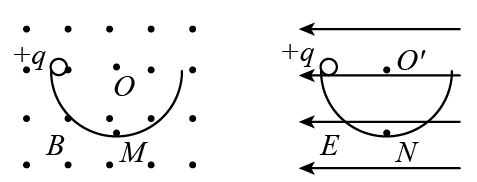

# Physics - 题目 616

**ID**: 8a09edf5cf844e66b7dceba7d12119c7
**年级**: Grade 11
**难度**: Medium-Hard
**题型**: Multiple-choice

## 题目
如图所示，两个半径相同的半圆形轨道分别竖直放在匀强电场和匀强磁场中，轨道两端在同一高度上，轨道是光滑的，两个相同的带正电小球同时从两轨道左端最高点由静止释放，M、N为轨道的最低点，以下说法正确的是（      ）​​​​​​​‌

## 解答

1. AC．小球在磁场中到达轨道最低点的过程中只有重力做功，
2. $v{{}_{M}}=\sqrt {2gR}$
3. 在电场中到达轨道最低点的过程中，重力做正功,电场力做负功，根据动能定理得
4. $mgR-qER=\frac {1}{2}mv{^{2}}{{}_{N}}$
5. 得
6. $v{{}_{N}}=\sqrt {2gR-2\frac {qER}{m}}$
7. 所以
8. $v{{}_{M}}>v{{}_{N}}$
9. 设两轨道左端最高点分别为X、Y，因为 $\overset ⌢{{XM}}=\overset ⌢{{YN}}$ ，所以该过程所用时间
10. $t{{}_{M}}<t{{}_{N}}$
11. 故AC错误；
12. BD．根据能量守恒定律知，在磁场中小球能到达轨道的另一端，在电场中不能到达轨道的另一端，两小球第一次到达最低点时，在M点
13. $F^{′}{{{}_{M}}}=mg+qv{{}_{M}}B+m\frac {v{^{2}}{{}_{M}}}{R}$
14. 在N点
15. $F^{′}{{{}_{N}}}=mg+m\frac {v{^{2}}{{}_{N}}}{R}$
16. 不难看出
17. $F^{′}{{{}_{M}}}>F^{′}{{{}_{N}}}$
18. 由牛顿第三定律可知
19. $F{{}_{M}}=F^{′}{{{}_{M}}},F{{}_{N}}=F^{′}{{{}_{N}}}$
20. 故B错误，D正确。
21. 故选D。

## 知识点

**中文**:
  - 带电粒子在匀强磁场中的运动

**English**:
  - Motion of Charged Particles in Uniform Magnetic Field

---
